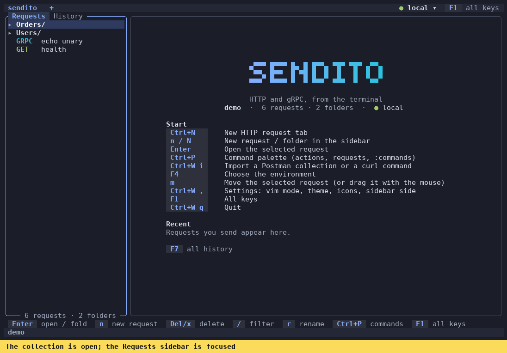
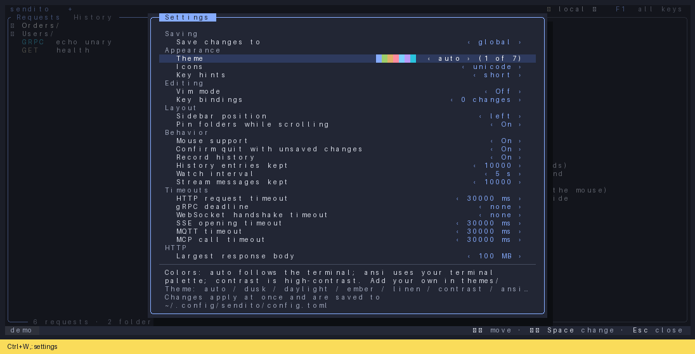
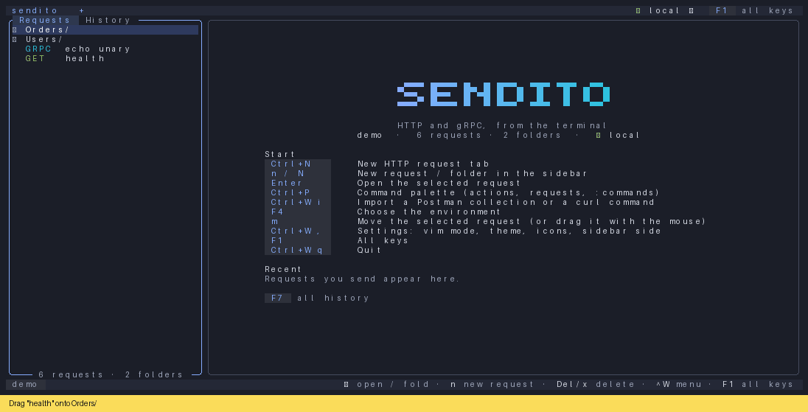
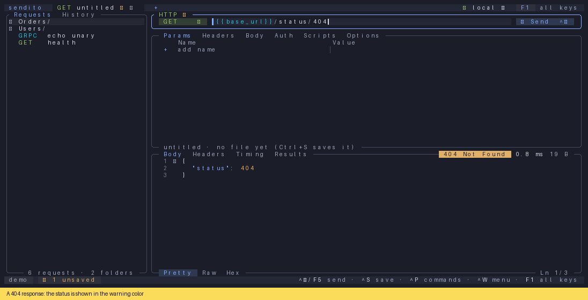
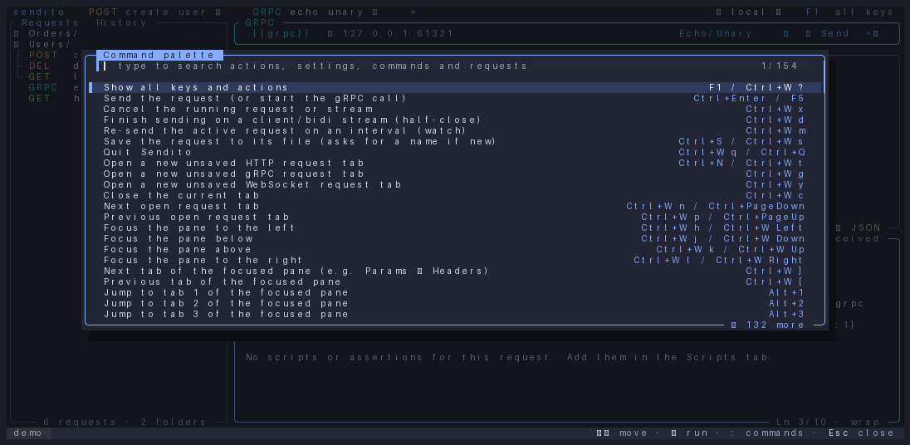
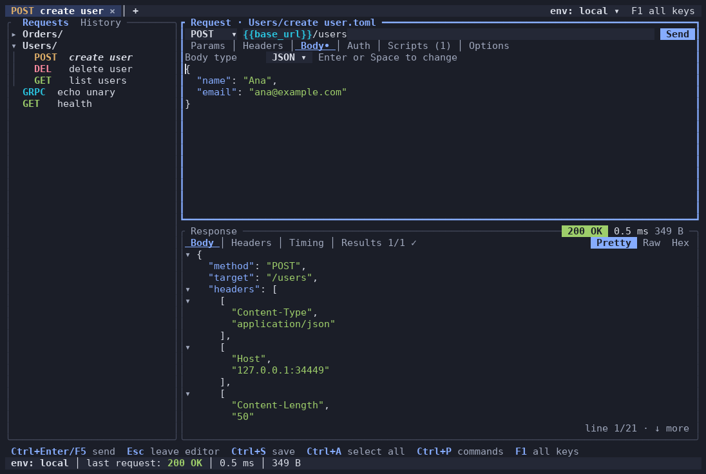
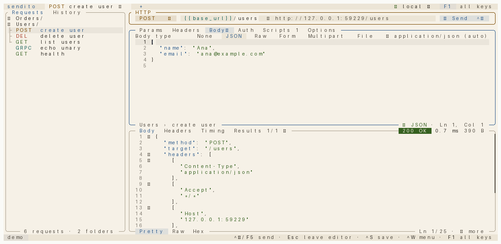
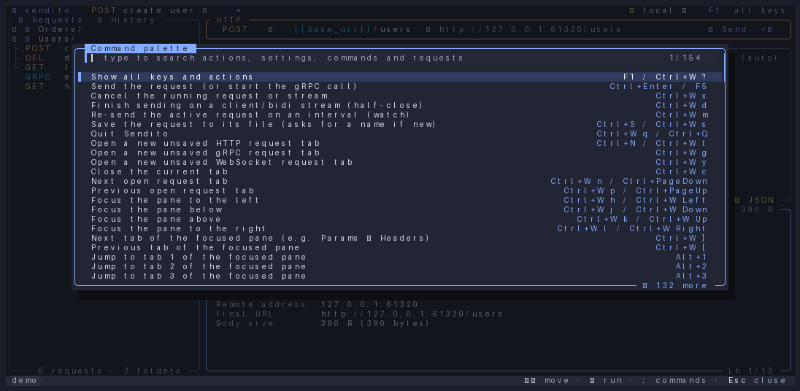
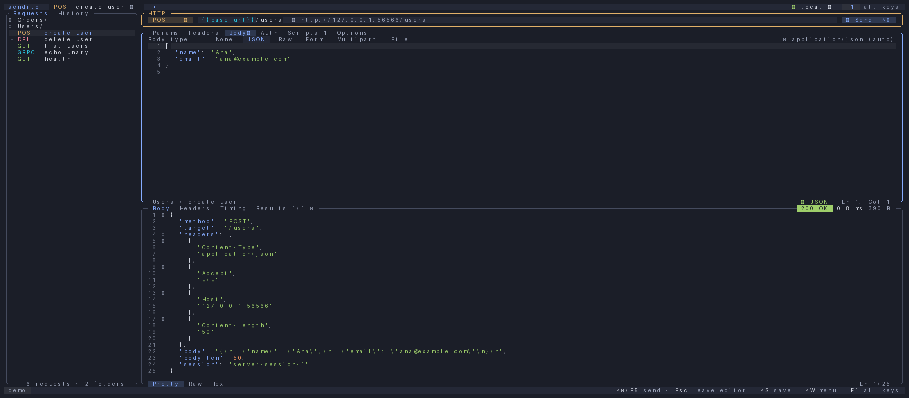
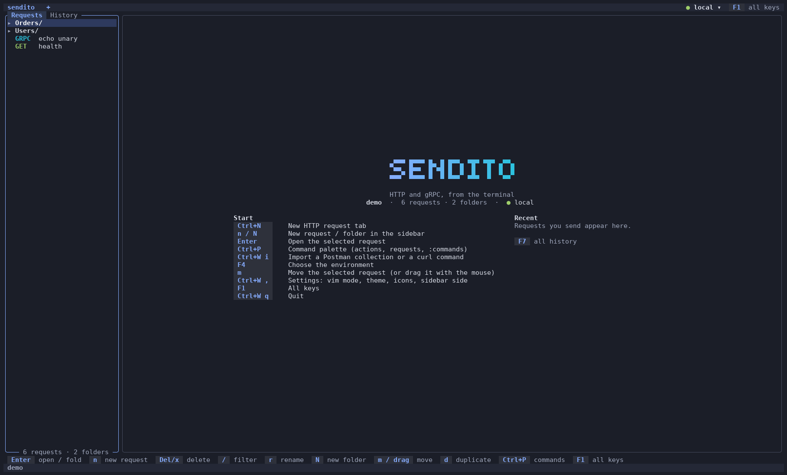

# Sendito

A terminal API client for **HTTP**, **gRPC**, **WebSocket** and **MCP tools**. It
runs locally in your terminal,
works with the mouse, conventional keys or vim keys, and keeps your requests as
plain TOML files you can version in git.

[](https://github.com/toninho09/sendito/actions/workflows/ci.yml)


**[Features](docs/FEATURES.md)** · **[CLI reference](docs/CLI.md)** · **[File formats](FORMAT.md)** · **[Key map](KEYMAP.md)** · **[Limitations](docs/DEBT.md)**


* **Correct on the wire.** Sendito sends what the request says: no hidden
  `User-Agent` or `Referer` headers, explicit rules for query and form encoding
  ([FORMAT.md](FORMAT.md)), and the headers you define in your order. Two small
  differences come from the HTTP library and are listed in
  [docs/DEBT.md](docs/DEBT.md): HTTP/1 header names are sent in Title-Case, and
  `Accept: */*` is added when you define no `Accept`.
  The headers added are framing (`Host`, `Content-Length`), auth, and a
  `Content-Type` from the body type when you define none (JSON → `application/json`,
  form → `application/x-www-form-urlencoded`, file → its content type or
  `application/octet-stream`; multipart file parts → guessed from the extension).
  A corpus of 49 HTTP, 15 gRPC, 12 WebSocket and 5 MCP cases is checked byte for
  byte in CI.
* **HTTP**: every method, query params, headers, raw / JSON / form / multipart
  (with files) / file bodies, Basic / Bearer / API-key / OAuth 2 auth, timeout, redirects,
  TLS verification, an optional proxy (`[http] proxy`, including `"env"` for
  `HTTPS_PROXY` and friends), a custom CA and client certificates for mutual
  TLS (`[http.tls]`), response decompression (gzip / deflate / br), watch mode and
  a DNS / connect / TLS / TTFB / download breakdown.
  → [HTTP features](docs/FEATURES.md#http)
* **gRPC**: services from server reflection or `.proto` files (compiled in-process,
  no `protoc`), unary, server-, client- and bidi-streaming calls, proto3 JSON
  messages with generated templates, metadata, TLS, deadlines, cancellation, and a
  Log tab for every message sent and received.
  → [gRPC features](docs/FEATURES.md#grpc)
* **WebSocket**: a session per request — handshake headers, subprotocols, a JSON
  document of text and binary frames sent on connect, frames received live in a
  Log tab, `wss://` with the same TLS material as HTTP, and the close code as the
  assertion status.
  → [WebSocket features](docs/FEATURES.md#websocket)
* **MCP tools**: call tools on stdio or Streamable HTTP servers, discover tools
  and generate initial arguments from their input schema, with bearer or OAuth
  2.1 authentication for HTTP servers.
  → [MCP features](docs/FEATURES.md#mcp)
* **Environments** with secrets from four sources: the env file, a gitignored
  secrets file, the OS keychain, or a file. Secrets are masked everywhere.
  An opt-in cookie jar keeps cookies per environment; `:cookies` manages them.
  Each redirect hop gets the jar's cookies for its own URL.
  → [Variables and secrets](docs/FEATURES.md#variables-and-secrets)
* **Scripts without code**: set variables before sending, extract values (JSONPath,
  header, status) after, and assert on them.
  → [Scripts](docs/FEATURES.md#scripts)
* **History**, **Postman / Bruno / Insomnia import**, **curl import/export**,
  `.http` export, session restore, seven themes plus your own, optional Nerd Font
  icons, and a key map you can change.
  → [Import and export](docs/FEATURES.md#import-and-export) ·
  [Themes](docs/FEATURES.md#themes-and-icons)

## Contents

- [Install](#install)
- [Quick start](#quick-start)
- [See it in action](#see-it-in-action)
- [HTTP](#http)
- [gRPC](#grpc)
- [WebSocket](#websocket)
- [MCP tools](#mcp-tools)
- [Environments and secrets](#environments-and-secrets)
- [Scripts (no code)](#scripts-no-code)
- [Watch, proxy and TLS](#watch-proxy-and-tls)
- [Cookie jar](#cookie-jar)
- [Import and export](#import-and-export)
- [History and session](#history-and-session)
- [Themes](#themes)
- [The screen](#the-screen)
- [Keys](#keys)
- [Command line](#command-line)
- [Development](#development)
- [License](#license)

## Install

Download a release archive for Linux x86_64 or macOS arm64 from the
[releases page](https://github.com/toninho09/sendito/releases), check it and put the
binary on your `PATH`:

```sh
tar xzf sendito-v0.2.0-x86_64-unknown-linux-gnu.tar.gz
sha256sum -c sendito-v0.2.0-x86_64-unknown-linux-gnu.tar.gz.sha256
sudo install sendito /usr/local/bin/
```

Or build from source (the repository pins Rust 1.100.0 in `rust-toolchain.toml`, which rustup installs on its own; the code needs 1.89 or newer — edition-2024 let chains need 1.88 and the jq filter library sets the floor at 1.89 — but nothing older than the pinned version is tested):

```sh
cargo install --path .
```

## Quick start

```sh
sendito init my-api        # creates my-api/.sendito and a "local" environment
cd my-api
sendito                    # opens the collection
```

In the app:

1. Press `n` in the sidebar to create a request (choose HTTP, gRPC, WebSocket or MCP
   and a folder):
   its file is created at once, empty. `Ctrl+N` instead opens a scratch tab that has
   no file until `Ctrl+S` asks for a name and folder.
2. Type the URL, e.g. `{{base_url}}/users`, and press **Ctrl+Enter** or **F5**.
   Sending uses the request as shown, unsaved edits included.
3. `Ctrl+S` saves; `F4` switches environment; `F1` lists every key.

Without the UI:

```sh
sendito run "Users/list users" --env local     # body to stdout, status to stderr
sendito run checks/health --env prod || echo "an assertion failed"
sendito run Users --env local                  # every request under Users, in tree order
sendito run . --env local --report json        # current folder (root = all), JSON summary
sendito run Users --env local --fail-fast      # stop at the first failure
sendito run Users --env local -i               # also print the response headers
sendito run "Users/create user" --no-history --env local
sendito curl "Users/create user" --env local   # print as curl (secrets stay {{placeholders}})
sendito http "Users/create user" --env local   # print as an .http file
sendito curl x --include-secrets --env local   # include secret values
sendito import acme.postman_collection.json    # Postman or Insomnia JSON
sendito import path/to/bruno-collection        # Bruno directory
sendito import acme.json --into "Imported"     # import into a subfolder
```

`sendito run` exits with 0 on success, 1 when an assertion fails or an MCP tool
returns `isError: true`, 2 when the request fails (network error, gRPC status other
than OK) and 3 on usage errors or unresolved variables. Every flag is documented in
the [CLI reference](docs/CLI.md#sendito-run-request).

Given a folder (or `.` for the current folder; at the collection root, `.` means
everything), `sendito run` sends every request below it in tree order — one
`PASS`/`FAIL`/`ERROR` line each and a summary — and **carries variables
forward**: a value a request extracts is available to the ones after it, so a
login followed by the calls that need its token works as one run.
`--fail-fast` stops at the first failure, `--report json` prints a structured
summary (counts and per-request status) to stdout, and the exit code is 0 (all
passed), 1 (an assertion or tool error), 2 (a request failed) or 3 (usage,
including unresolved variables). Folder runs go to History only when history
is enabled, exactly like single requests.

## See it in action

Twelve short recordings of the main flows, rendered from the app's own frames
(`make media && make render`) so they never drift from the UI. The full-size
files are in [`docs/media/recordings/`](docs/media/recordings).

| Flow | Recording |
|---|---|
| **Create a folder and a request** |  |
| **Send a GET, then a POST with a JSON body** |  |
| **Multipart body with a file part** |  |
| **Undefined variable → switch env → send** |  |
| **gRPC unary call via reflection** |  |
| **gRPC bidi stream: send, half-close** |  |
| **Import a Postman collection** |  |
| **Paste curl, export as curl** |  |
| **Resend from History** |  |
| **Vim mode editing** |  |
| **Drag a request into a folder** |  |
| **Errors, cancel, delete** |  |

## HTTP

A request is one TOML file. The request tabs are **Params · Headers · Body ·
Auth · Scripts · Options**, and the wire rules are spelled out in
[FORMAT.md](FORMAT.md#what-goes-on-the-wire).

* **Bodies**: none, raw, JSON, form-urlencoded, multipart (text and file parts) or
  a file. A JSON body is validated as you type (`✓ JSON` / `✗ JSON: line, col`).
* **Auth**: Basic, Bearer, API key (header or query) and OAuth 2 with PKCE. A `401`
  triggers one token refresh and retry; tokens live in the OS keychain.
* **Options per request**: timeout, follow redirects (up to 10 hops, no `Referer`;
  authentication is not sent to another origin), TLS verification and the cookie jar.
* **Responses**: pretty JSON with folding, raw and hex views, search, the
  response headers beside the request that was actually sent, and a timing
  waterfall (DNS / connect / TLS / TTFB / download).
* **Decoding**: `gzip`, `deflate` and `br` are decompressed for display,
  extraction and assertions; any other coding is shown as received.
* **Watch**: `Ctrl+W m` re-sends the active request on an interval and draws a
  sparkline in Timing.

| | |
|---|---|
|  |  |

More, including proxy, TLS and decompression details: [HTTP features](docs/FEATURES.md#http).

### HTTP OAuth

Configure an identity in `.sendito/config.toml`:

```toml
[oauth.example]
authorize_url = "https://example.com/authorize"
token_url = "https://example.com/token"
client_id = "client"
client_secret = "{{client_secret}}"  # optional; use a secret environment source
scopes = ["read"]
```

Run `sendito auth login example --env local`, or `:auth login example` in the
app with `local` active. In the request's Auth tab select **OAuth 2** and enter
`example`. Tokens are stored in the OS keychain per collection, environment and
identity. A 401 triggers one token refresh and retry. Use `sendito auth logout
example --env local` or `:auth logout example` to remove them. OAuth endpoints
and protected URLs must use HTTPS except on loopback. See [FORMAT.md](FORMAT.md).

## gRPC

* Discover services and methods through **server reflection** or from `.proto`
  files compiled in-process (no `protoc`).
* **Unary, server-streaming, client-streaming and bidi** calls. The message is
  proto3 JSON, starting from a template generated from the schema; on an open
  stream each send pushes one more message and `Ctrl+W d` half-closes.
* **Metadata** rows, TLS or plaintext, deadlines and cancellation.
* The **Log** tab lists every message sent and received with a timestamp
  (`→` sent, `←` received, `■` status, `+s` elapsed).

| | |
|---|---|
|  |  |


More: [gRPC features](docs/FEATURES.md#grpc).

## WebSocket

```toml
kind = "websocket"
url = "wss://echo.example.com/chat"
subprotocols = ["chat.v2"]
messages = '''
[
  "hello",
  { "binary": "AAEC" }
]
'''
```

* One **session** per request: the handshake carries the request's headers,
  subprotocols and auth; `wss://` uses the same `[http.tls]` material as HTTP,
  and an `http(s)://` `[http] proxy` is tunnelled with `CONNECT`.
* The **message document** is JSON: strings are text frames and
  `{ "binary": "base64" }` objects are binary frames. It is sent right after the
  handshake.
* **Live frames**: everything the server sends appears in the **Log** tab as it
  arrives; on an open session Send pushes the editor's content as one more
  frame, `Ctrl+W d` starts the close handshake and `Ctrl+W x` aborts it.
* The **Handshake** tab shows the upgrade response, **Timing** the handshake,
  first frame and close plus the frame counters, and the last text frame is the
  **Body**. Scripts see the close code as `status`.
* `sendito run` prints the text frames received on stdout and exits `2` unless
  the session closes with `1000`.

More: [WebSocket features](docs/FEATURES.md#websocket).

## MCP tools

Configure a server in `.sendito/config.toml`:

```toml
[mcp.servers.local]
command = "my-mcp-server"
args = ["--stdio"]

[mcp.servers.remote]
url = "https://example.com/mcp"
[mcp.servers.remote.auth]
type = "bearer"
token = "{{token}}"
```

Create an MCP request with `n` in the tree or `:newmcp` in the palette. Type the
server and tool names, or use F2 on the server or tool field to choose from the
configured servers or discover tools. Tool selection fills initial arguments when
the unchanged editor is empty or contains `{}`. Set the arguments and press F5 to call.

Servers can also be added from the interface: `Ctrl+W S` (or `:mcpservers edit`)
lists them as a table and saves `[mcp.servers]` to the project config, and
`:mcpadd <name>` asks for the URL or command and adds one at once. The server field
takes a configured name or a direct `http(s)://` URL.

For OAuth, you do not need to edit the file: call a tool or list the tools, and
when the server asks for a sign-in the app shows "Sign in now?". Sign in opens the
browser, stores the tokens in the OS keychain, saves `type = "oauth"` for the server
and runs the call again. You can also sign in with `:auth login remote` in the app
or `sendito mcp login remote` in a shell, and sign out with `:auth logout remote` or
`sendito mcp logout remote`. The redirect must reach Sendito's local loopback
listener. The servers editor (`Ctrl+W S`) also sets the auth of each server. See [FORMAT.md](FORMAT.md) for all
options and [docs/DEBT.md](docs/DEBT.md) for current MCP limitations.



More: [MCP features](docs/FEATURES.md#mcp).

## Environments and secrets

Variables are written `{{name}}` anywhere: URL, params, headers, bodies, gRPC
messages and metadata, auth fields. Collection variables apply to every
environment; the active environment overrides them; scripts override both.
Undefined variables are shown in red and named in the status line, and sending
asks before going ahead. Dynamic values such as `{{$uuid}}`, `{{$timestamp}}` and
`{{$randomInt}}` are generated once per send.

```toml
# .sendito/environments/local.toml
[variables]
base_url = "http://localhost:8080"          # plain text, versioned
token = { source = "local" }                # .sendito/secrets.toml (gitignored;
                                            # "secrets" in the environment editor)
api_key = { source = "keychain" }           # OS keychain
client_key = { source = "file", path = "~/.acme/key" }
```

Set secret values in the environment editor (`Ctrl+W V`), which writes them to
the right place and shows whether each one is set. Secret values are never
shown, never written to history and never included in curl exports unless you
run `:curl!`. When a server echoes a secret back (in a body, a header or gRPC
metadata), as sent, JSON-escaped or percent-encoded, the app shows `••••••` in
its place (secrets under 3 characters are not masked); `sendito run` writes the
body to stdout unchanged.

| | |
|---|---|
|  |  |

More: [variables and secrets](docs/FEATURES.md#variables-and-secrets).

## Scripts (no code)

The **Scripts** tab has three sections:

* **Pre-request**: set variables, e.g. `request_id = req-{{$uuid}}`.
* **Extract**: after the response, store a JSONPath result, a header or the status
  in a variable (optionally secret), e.g. `token ← $.access_token`.
* **Assertions**: check status, a header or a JSONPath value with
  `== != contains !contains exists !exists < <= > >= matches`. Results appear in
  the **Results** tab (**Log** for gRPC) and decide the exit code of
  `sendito run`.

More: [scripts](docs/FEATURES.md#scripts).

## Watch, proxy and TLS

* **Watch** — `Ctrl+W m` or `:watch [seconds]` re-sends the active HTTP request on
  an interval (`ui.watch_interval_s`, default 5). It stops on cancel, tab close,
  environment change or unresolved variables and is not written to history.
* **Proxy** — `[http] proxy` takes a URL (`http://`, `https://`, `socks4/4a/5/5h`,
  credentials allowed) or `"env"` to read `HTTPS_PROXY` / `HTTP_PROXY` /
  `ALL_PROXY` / `NO_PROXY` with curl's precedence. HTTP requests and MCP over
  Streamable HTTP use it; gRPC does not.
* **TLS** — `[http.tls]` sets a `ca` PEM bundle that replaces the platform roots
  and a `client_cert` + `client_key` pair for mutual TLS. Paths are relative to the
  collection root. Used by HTTP, gRPC and MCP over Streamable HTTP.

```toml
[http]
timeout_ms = 30000
max_body_mb = 100
proxy = "env"

[http.tls]
ca = "certs/corp-ca.pem"
client_cert = "certs/client.pem"
client_key = "certs/client.key"
```

More: [HTTP features](docs/FEATURES.md#http).

## Cookie jar

The cookie jar is opt-in (`[options] cookies = true` or `[http] cookie_jar = true`).
Cookies are isolated by environment, parsed with RFC 6265 and the public suffix
list, and stored in a private file with a cross-process lock. `:cookies` lists
them masked, `:cookies delete <n>` removes one, `:cookies clear` empties the
environment's jar, and `sendito run --no-cookies` disables it for a run.
On a redirect, each hop gets the jar's `Cookie` header for its own URL, so a
cookie does not leave its path or origin scope.

More: [HTTP features](docs/FEATURES.md#http) · [FORMAT.md](FORMAT.md#cookie-jar).

## Import and export

* `Ctrl+W i` (or `:import path`) imports a Postman Collection v2.1, an Insomnia
  v4/v5 JSON export, or a Bruno collection directory. Relative paths are looked up
  in the working directory, then the collection folder. Supported requests,
  folders, authentication and variables are imported; selectable environments
  are created with unique names. A report lists skipped or changed items. Private
  Insomnia environments and Bruno secret variables are not imported; configure
  their secrets separately. Scripts, advanced template expressions, and unsupported
  auth/body types are reported rather than silently converted.
* Paste a `curl …` command into the URL field or the import dialog to turn it into
  a request. `Ctrl+W u` (or `:curl`) copies the request as curl; `:httpfile` (or
  `sendito http <request>`) copies it as an `.http` file (JetBrains HTTP client /
  VS Code REST Client). Both keep secrets as `{{placeholders}}` unless you run
  `:curl!` / `:httpfile!`. For Basic auth with unresolved credentials, `.http`
  export requires `{{sendito_basic_credentials}}` to be set to base64(username:password).

| | |
|---|---|
|  |  |

More: [import and export](docs/FEATURES.md#import-and-export).

## History and session

Every sent request is appended to `.sendito/history.jsonl` with its
`{{variables}}` intact and secrets masked (no bodies), and trimmed at
`history.max_entries` (default 10 000). `F7` opens History grouped by day with
the status in color; opening or resending an entry resolves it again with the
active environment. Open tabs, drafts, the active environment and the layout are
restored from `.sendito/session.toml` on the next start.


More: [storage](docs/FEATURES.md#storage) · [FORMAT.md](FORMAT.md#local-state-files).

## Themes

`auto` follows the terminal background; the rest are `dusk`, `daylight`, `ember`,
`linen`, `contrast` and `ansi` (the terminal's own 16 colors). `NO_COLOR=1` turns
colors off. Your own themes are TOML files in `~/.config/sendito/themes/` or the
collection's `.sendito/themes/`; a theme can extend another and change only some
colors. `sendito theme list` shows every theme (add `--collection <path>` to
include that collection's themes), `sendito theme print dusk >
~/.config/sendito/themes/mine.toml` starts a new one, and `:theme mine` or
`:theme reload` applies it. See [docs/THEMES.md](docs/THEMES.md).

| dusk | daylight |
|---|---|
|  |  |
| **ember** | **linen** |
|  |  |
| **contrast** | **ansi** |
|  |  |



The Settings dialog (`Ctrl+W ,`) changes, at once:

| Setting | What it does |
|---|---|
| Theme | colors; `auto` follows the terminal background |
| Icons | `unicode` (works with any font) or `nerd` (needs a [Nerd Font](https://www.nerdfonts.com)) |
| Key hints | keys in the footer: `full`, `short` (the most used) or `off` (`ui.hints`) |
| Vim mode | vim keys in editors and lists (normal / insert modes) |
| Sidebar position | Requests / History sidebar on the left or right |
| Mouse support | clicks, wheel scrolling, dragging tree items and pane borders |
| Confirm quit with unsaved changes | ask before quitting while tabs have unsaved changes |
| Record history | keep sent requests in History (`F7`) to reopen or resend |
| Watch interval | default seconds between watch re-sends (`ui.watch_interval_s`) |

It also holds the timeouts, the largest response body, the cookie jar, the
proxy, the TLS files and the collection name and skipped directories. Number,
path and text values are typed in a dialog that checks them. **Save changes to**
chooses the global file or the project file. `:oauth` edits the HTTP OAuth
identities and `:keymap` your key bindings; `Ctrl+O` in the MCP servers editor
edits a server's env, headers and OAuth fields. See
[Settings](docs/FEATURES.md#settings).

## The screen



* **Top bar**: the name, the open requests (`●` = unsaved changes, a spinner while
  one runs), `+` for a new one, the environment chip and `F1 all keys`. The
  environment chip takes its color from the name: `prod`/`live` red,
  `staging`/`qa`/`test`/`uat` yellow, `local`/`dev` green.
* **URL strip**: above both panes, the same parts for every kind — a chip
  (HTTP method, gRPC method, MCP tool; WebSocket a static `WS` badge) and one
  endpoint input (URL, gRPC target or MCP server) with its `{{variables}}`
  highlighted, then **Cancel** and **Send**. HTTP and WebSocket draw
  `[chip][input]`; gRPC draws `[target][method ▾]`; MCP draws
  `[server][address][tool ▾]`. The MCP server input takes a name from
  `[mcp.servers]` or a direct `http(s)://` URL.
* **Sidebar**: **Requests** (the collection tree, with `├ └` connectors) or
  **History** (grouped by day, status in color). Requests that are open in a tab
  are in the accent color. `/` filters and highlights the match; the bottom border
  counts requests and folders. The sidebar can be on the right and resized.
* **Request**: the tabs **Params · Headers · Body · Auth · Scripts · Options**
  (gRPC: **Message · Metadata · Auth · Scripts · Options**) sit in the pane's top
  border (MCP: **Tool · Args · Scripts · Options**), with the folder path of the request (`Users › create user`) on the right.
  A tab label shows its number of rows, `Headers 2`, or `•` when Body or Auth is
  set. Editors have line numbers; a JSON body shows `✓ JSON` or
  `✗ JSON: line, col` and the cursor position (`Ln, Col`) in the bottom border.
* **Response**: status, time and size in the border, then **Body** (pretty JSON
  with folding and line numbers, raw, hex, search; `Pretty Raw Hex` and the
  position in the bottom border) · **Headers** (response and the request that was
  sent, secrets masked) · **Timing** (a DNS / connect / TLS / wait / download
  waterfall) · **Results** (assertions, extracted variables, notes). For gRPC the
  tabs are **Body · Metadata · Timing · Log**, where Log lists every message sent
  and received (legend pinned on top: `→` sent, `←` received, `■` final status,
  `+s` seconds since the call started) plus the results.
  gRPC messages are shown as proto3 JSON: fields holding their default value
  are not on the wire and are not shown (assertions still see them, so
  `$.count == 0` works).
* Long content has a scrollbar in the pane border. Dialogs open over a dimmed
  screen.
* **Footer**: one row. Status segments on the left (vim mode, unsaved count,
  undefined variables); the most useful keys for what is focused on the right
  (`[ui] hints`: `full`, `short` or `off`), and messages between them. The
  environment is only shown in the top bar; the last request's status, time and
  size appear here only while the Response pane is hidden.
* **Ctrl+W menu**: press `Ctrl+W` and wait: a box lists every key that can
  follow, by group. Press the key or click the entry.

With no request open, the start screen shows what the collection holds, the keys
to get going and the most recent requests (click one to open it).



Panels resize with the mouse (drag the borders) or `Ctrl+W <`/`>` and `Ctrl+W +`/`-`;
`Ctrl+W z` maximizes the focused pane, `Ctrl+B` hides the sidebar. 120×40 and
200×60 are the tested sizes; smaller terminals adapt down to 40×8.

## Keys

Conventional keys by default; vim mode in Settings (`Ctrl+W ,`). The most used:

| Key | Action |
|---|---|
| `Ctrl+Enter` / `F5` / `Ctrl+W e` | send (on an open client/bidi stream: send the next message; the sent text stays selected so you can type the next one over it) |
| `Ctrl+W x` | cancel the running request or stream |
| `Ctrl+W m` | watch: re-send the active HTTP request every few seconds (`:watch 10` sets the interval; the Timing tab shows a sparkline) |
| `Ctrl+W d` | end the request stream (client/bidi gRPC) |
| `Ctrl+S` | save (asks for a name and folder the first time) |
| `Ctrl+P` | command palette: actions, requests, environments and `:commands` |
| `Tab` / `Shift+Tab` | next / previous field or pane |
| `Ctrl+W h/j/k/l` | focus left / down / up / right |
| `Ctrl+W n` / `Ctrl+W p` | next / previous tab · `Ctrl+W c` close · `Ctrl+N` new HTTP · `Ctrl+W g` new gRPC |
| `Alt+1`…`Alt+6`, `Ctrl+W ]`/`[` | switch the tabs of the focused pane |
| `F4` | environment · `Ctrl+W V` edit environments |
| `F7` | history · `Ctrl+W i` import · `Ctrl+W u` copy as curl |
| `F1` | help (the full key map) · `Ctrl+W q` quit |

In the sidebar: `n` new request, `N` new folder, `r` rename, `d` duplicate,
`m` move, `Delete` delete, `/` filter. In the response: `p`/`r`/`x` pretty / raw /
hex, `/` search with `n`/`N`, `Enter` fold, `-`/`+` fold / unfold all, `w` wrap,
`y` copy, `s` save the body. Tables: `Enter` next cell, `Ctrl+T` enable/disable a
row, `Ctrl+D` delete it.

Copying (`y`, `Ctrl+W u`) goes through the terminal's clipboard support (OSC 52);
inside tmux enable it with `set -g set-clipboard on`.

Ctrl+Enter needs a terminal that reports it (kitty, Alacritty, WezTerm, foot,
Ghostty, iTerm2 with CSI u); `F5` and `Ctrl+W e` work everywhere.

[KEYMAP.md](KEYMAP.md) lists every action and is generated from the same table as
the in-app help. Keys can be changed per action and mode in the config:

```toml
[keymap.all]
send = ["f9", "ctrl+w e"]
[keymap.vim]
tree_delete = "D"
```

### Mouse

Click to focus, select rows, switch and close tabs (middle-click closes too) and
press buttons; double-click opens a request; drag a tree item onto a folder to
move it; drag pane borders to resize; the wheel scrolls the pane under the pointer.


### Vim mode

Editors are modal (normal / insert / visual / visual-line) with `hjkl`, `w b e`,
`0 ^ $`, `gg G`, `x dd D cc C yy p P u Ctrl+R`, `v V` then `d y c`, and `:` opens
the palette in command mode (`:w`, `:send`, `:env dev`, `:q`). The tree and the
response viewer use `hjkl`, `gg`/`G` and `/`. The status line shows the mode.


## Command line

Every subcommand, flag and exit code is in the [CLI reference](docs/CLI.md).

| Command | What it does |
|---|---|
| `sendito [PATH]` | Open the collection (nearest `.sendito/`, else the current directory) |
| `sendito init [PATH]` | Create a collection |
| `sendito run <request\|folder>` | Send one request or a whole folder headless |
| `sendito curl <request>` | Print the request as curl |
| `sendito http <request>` | Print the request as an `.http` file |
| `sendito auth login\|logout <name>` | HTTP OAuth with PKCE, tokens in the OS keychain |
| `sendito mcp login\|logout <server>` | OAuth login for an MCP server |
| `sendito theme list` / `print <name>` | List themes / print one as a file |
| `sendito import <file\|dir>` | Import Postman, Insomnia or Bruno |

## Development

```sh
cargo test --workspace            # unit, integration, corpus, UI flows, snapshots
cargo run -p sendito-testkit --bin echo-servers   # or make servers: HTTP :8787, gRPC :50051, WS :8788, MCP :8789
cargo clippy --all-targets -- -D warnings && cargo fmt --check
```

The `Makefile` wraps the recurring commands with quiet, token-efficient output
(`make help` lists them):

| Target | Does |
|---|---|
| `make build` / `make check` | Build the workspace / type-check only (`P=` for one crate) |
| `make servers` | Echo servers for manual tests (HTTP, gRPC, WS, MCP) |
| `make test` | Full test suite (unit, integration, corpus, UI); `P=` and `F=` narrow it to one crate or test name |
| `make lint` / `make fmt` / `make deny` | Clippy `-D warnings` (`P=` for one crate) / rustfmt / cargo-deny |
| `make ci` | `fmt-check` + `lint` + `deny` + `test`, in order |
| `make docs` | Check that the paths, symbols and `make` targets the documentation cites exist |
| `make corpus` / `make corpus-update` | Run the wire corpus / rewrite its goldens |
| `make keymap` | Regenerate `KEYMAP.md` |
| `make snap` | Accept the insta UI snapshots |
| `make media` / `make render` | Generate the frames / render screenshots and GIFs |
| `make bundles` | Build the reviewer bundles |
| `make cov` / `make bench` | Line coverage of every crate but the UI, by the whole test suite / benchmarks |

Crates: `sendito-core` (model, variables, resolution, scripts), `sendito-http`,
`sendito-grpc`, `sendito-ws`, `sendito-mcp` (stdio and Streamable HTTP MCP client, OAuth),
`sendito-store` (files, request format, environments, secrets, config, history,
cookies, session, themes), `sendito-import` (Postman, Insomnia, Bruno, curl,
`.http`), `sendito-pipeline` (send pipeline and response document model),
`sendito-ui` (terminal UI), `sendito-testkit`
(test servers) and the `sendito` binary. See
[docs/ARCHITECTURE.md](docs/ARCHITECTURE.md) for the data flow and the test
layers, and [AGENTS.md](AGENTS.md) for the rules that keep them green.

Dependencies are the official crates.io releases (no vendored or patched crates).
Known limitations and trade-offs are listed in [docs/DEBT.md](docs/DEBT.md).

The correctness corpus lives in `tests/corpus`: every request there is sent to the
echo servers and the exact bytes received are compared with
`tests/corpus/expected`. `UPDATE_CORPUS=1 cargo test --test corpus` rewrites them.

## Documentation

Start at the [documentation index](docs/README.md).

| Document | Contents |
|---|---|
| [docs/FEATURES.md](docs/FEATURES.md) | Every feature, grouped by area |
| [docs/CLI.md](docs/CLI.md) | Every subcommand, flag, exit code, JSON report |
| [FORMAT.md](FORMAT.md) | Request / environment / config schema and wire rules |
| [KEYMAP.md](KEYMAP.md) | Generated key map |
| [docs/ARCHITECTURE.md](docs/ARCHITECTURE.md) | Crates, send pipeline, tests |
| [docs/THEMES.md](docs/THEMES.md) | Theme format and color tokens |
| [docs/DEBT.md](docs/DEBT.md) | Known limitations |
| [docs/media/README.md](docs/media/README.md) | How the screenshots and GIFs are made |
| [docs/reports/](docs/reports/) | Coverage, performance, UX and correctness reports |
| [CHANGELOG.md](CHANGELOG.md) | Release history |

## License

Licensed under either of [Apache License, Version 2.0](LICENSE-APACHE) or
[MIT license](LICENSE-MIT) at your option.
