# Sendito

A terminal API client for **HTTP**, **gRPC**, **WebSocket**, **SSE**, **MQTT** and **MCP tools**. It
runs locally in your terminal,
works with the mouse, conventional keys or vim keys, and keeps your requests as
plain TOML files you can version in git.

[](https://github.com/toninho09/sendito/actions/workflows/ci.yml)


**[Features](docs/FEATURES.md)** · **[CLI reference](docs/CLI.md)** · **[File formats](FORMAT.md)** · **[Key map](KEYMAP.md)** · **[Limitations](docs/DEBT.md)**

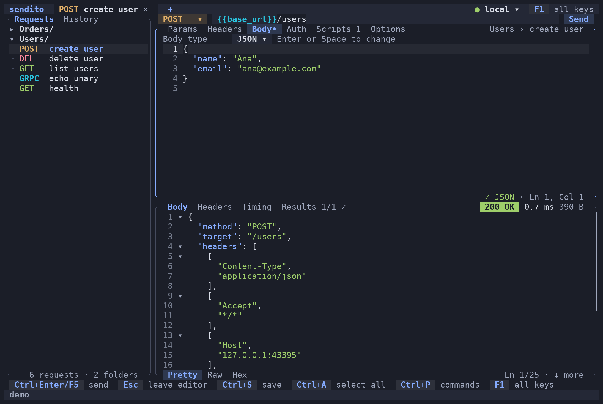

* **Correct on the wire.** Sendito sends what the request file defines, with
  your headers in your order and no hidden `User-Agent` or `Referer`.
  [FORMAT.md](FORMAT.md#what-goes-on-the-wire) lists the few headers it adds,
  and [docs/DEBT.md](docs/DEBT.md) the two that come from the HTTP library.
  A corpus of cases for every protocol is checked byte for byte in CI.
* **HTTP**: every method, query params, headers, raw / JSON / form / multipart
  (with files) / file bodies, Basic / Bearer / API-key / OAuth 2 / Digest /
  AWS SigV4 / JWT auth, timeout, redirects,
  TLS verification, an optional proxy (`[http] proxy`, including `"env"` for
  `HTTPS_PROXY` and friends), a custom CA and client certificates for mutual
  TLS (`[http.tls]`), response decompression (gzip / deflate / br), watch mode and
  a DNS / connect / TLS / TTFB / download breakdown.
  → [HTTP features](docs/FEATURES.md#http)
* **gRPC**: services from server reflection or `.proto` files (compiled in-process,
  no `protoc`), unary, server-, client- and bidi-streaming calls, proto3 JSON
  messages with generated templates, metadata, TLS, deadlines, cancellation, and a
  Log tab for every message sent and received.
  → [gRPC features](docs/FEATURES.md#grpc)
* **WebSocket**: a session per request — handshake headers, subprotocols, a JSON
  document of text and binary frames sent on connect, frames received live in a
  Log tab, `wss://` with the same TLS material as HTTP, and the close code as the
  assertion status.
  → [WebSocket features](docs/FEATURES.md#websocket)
* **SSE**: a live session per request — query parameters, headers, the HTTP
  auth and cookies, events received live with a jq filter, and optional
  `max_events` and `deadline_ms` limits.
  → [SSE features](docs/FEATURES.md#sse)
* **MQTT**: one session per send — connect, subscribe, publish and receive,
  MQTT 3.1.1 or 5 over TCP or TLS, QoS 0 to 2, retained messages and a Last
  Will.
  → [MQTT features](docs/FEATURES.md#mqtt)
* **MCP tools**: call tools on stdio or Streamable HTTP servers, discover tools
  and generate initial arguments from their input schema, with bearer or OAuth
  2.1 authentication for HTTP servers.
  → [MCP features](docs/FEATURES.md#mcp)
* **Environments** with secrets from four sources: the env file, a gitignored
  secrets file, the OS keychain, or a file. Secrets are masked everywhere.
  An opt-in cookie jar keeps cookies per environment; `:cookies` manages them.
  Each redirect hop gets the jar's cookies for its own URL.
  → [Variables and secrets](docs/FEATURES.md#variables-and-secrets)
* **Scripts**: set variables before sending, extract values (JSONPath,
  header, status) after, and assert on them; or write the logic in
  [Lua](https://www.lua.org) when rows are not enough.
  → [Scripts](docs/FEATURES.md#scripts)
* **Folder settings** (`folder.toml`): headers, auth, variables and scripts that
  every request below a folder inherits. `s` on a tree folder opens them.
  → [Folder settings](docs/FEATURES.md#folder-settings)
* **Saved example responses**: `:saveexample` keeps a response next to its
  request; `:examples` lists them.
  → [Saved examples](docs/FEATURES.md#saved-examples)
* **AI agents**: `sendito serve` makes a collection an MCP server, so an agent
  can list, read, send and write requests. Secret values are not shown to it.
  → [Agents](docs/FEATURES.md#agents)
* **History**, **Postman / Bruno / Insomnia / OpenAPI / `.http` import**,
  **curl import/export**, `.http` export, session restore, seven themes plus
  your own, optional Nerd Font icons, and a key map you can change.
  → [Import and export](docs/FEATURES.md#import-and-export) ·
  [Themes](docs/FEATURES.md#themes-and-icons)

## Contents

- [Install](#install)
- [Quick start](#quick-start)
- [See it in action](#see-it-in-action)
- [Documentation](#documentation)
- [License](#license)

Every feature, with its keys and settings, is described in
[docs/FEATURES.md](docs/FEATURES.md).

## Install

Download a release archive for Linux x86_64 or macOS arm64 from the
[releases page](https://github.com/toninho09/sendito/releases), check it and put the
binary on your `PATH`:

```sh
tar xzf sendito-v0.2.0-x86_64-unknown-linux-gnu.tar.gz
sha256sum -c sendito-v0.2.0-x86_64-unknown-linux-gnu.tar.gz.sha256
sudo install sendito-v0.2.0-x86_64-unknown-linux-gnu/sendito /usr/local/bin/
```

On macOS, use `shasum -a 256 -c` instead of `sha256sum -c`.

Or build from source. You need Rust 1.89 or newer and a C compiler (the Lua
engine is compiled with Sendito). The repository pins Rust 1.100.0 in
`rust-toolchain.toml`, and rustup installs it on its own:

```sh
git clone https://github.com/toninho09/sendito
cd sendito
cargo install --locked --path .
```

## Quick start

```sh
sendito init my-api        # creates my-api/.sendito and a "local" environment
cd my-api
sendito                    # opens the collection
```

In the app:

1. Press `n` in the sidebar to create a request (choose HTTP, gRPC, WebSocket,
   SSE, MQTT or MCP and a folder):
   its file is created at once, empty. `Ctrl+N` instead opens a scratch tab that has
   no file until `Ctrl+S` asks for a name and folder.
2. Type the URL, e.g. `{{base_url}}/users`, and press **Ctrl+Enter** or **F5**.
   Sending uses the request as shown, unsaved edits included.
3. `Ctrl+S` saves; `F4` switches environment; `F1` lists every key.

The [guides](docs/GUIDES.md) continue from here: environments and secrets, a
login flow, CI, import from Postman and gRPC.

Without the UI:

```sh
sendito run "Users/list users" --env local     # body to stdout, status to stderr
sendito run checks/health --env prod || echo "an assertion failed"
sendito run Users --env local                  # every request under Users, in tree order
sendito run . --env local --report json        # current folder (root = all), JSON summary
sendito run Users --env local --fail-fast      # stop at the first failure
sendito run Users --env local -i               # also print the response headers
sendito run "Users/create user" --no-history --env local
sendito curl "Users/create user" --env local   # print as curl (secrets stay {{placeholders}})
sendito http "Users/create user" --env local   # print as an .http file
sendito curl x --include-secrets --env local   # include secret values
sendito import acme.postman_collection.json    # Postman or Insomnia JSON
sendito import path/to/bruno-collection        # Bruno directory
sendito import openapi.yaml                    # OpenAPI or Swagger document
sendito import requests.http                   # .http / .rest file
sendito import acme.json --into "Imported"     # import into a subfolder
```

`sendito run` exits with 0 on success, 1 when an assertion fails or an MCP tool
returns `isError: true`, 2 when the request fails (network error, gRPC status other
than OK) and 3 on usage errors or unresolved variables. Every flag is documented in
the [CLI reference](docs/CLI.md#sendito-run-request).

Given a folder (or `.` for the current folder; at the collection root, `.` means
everything), `sendito run` sends every request below it in tree order — one
`PASS`/`FAIL`/`ERROR` line each and a summary — and **carries variables
forward**: a value a request extracts is available to the ones after it, so a
login followed by the calls that need its token works as one run.
`--fail-fast` stops at the first failure, `--report json` prints a structured
summary (counts and per-request status) to stdout, and the exit code is 0 (all
passed), 1 (an assertion or tool error), 2 (a request failed) or 3 (usage,
including unresolved variables). Folder runs go to History only when history
is enabled, exactly like single requests.

## See it in action

Short recordings of the main flows, rendered from the app's own frames
(`make media && make render`, before each release). The full-size files are in
[`docs/media/recordings/`](docs/media/recordings).

| Flow | Recording |
|---|---|
| **Create a folder and a request** |  |
| **Send a GET, then a POST with a JSON body** | 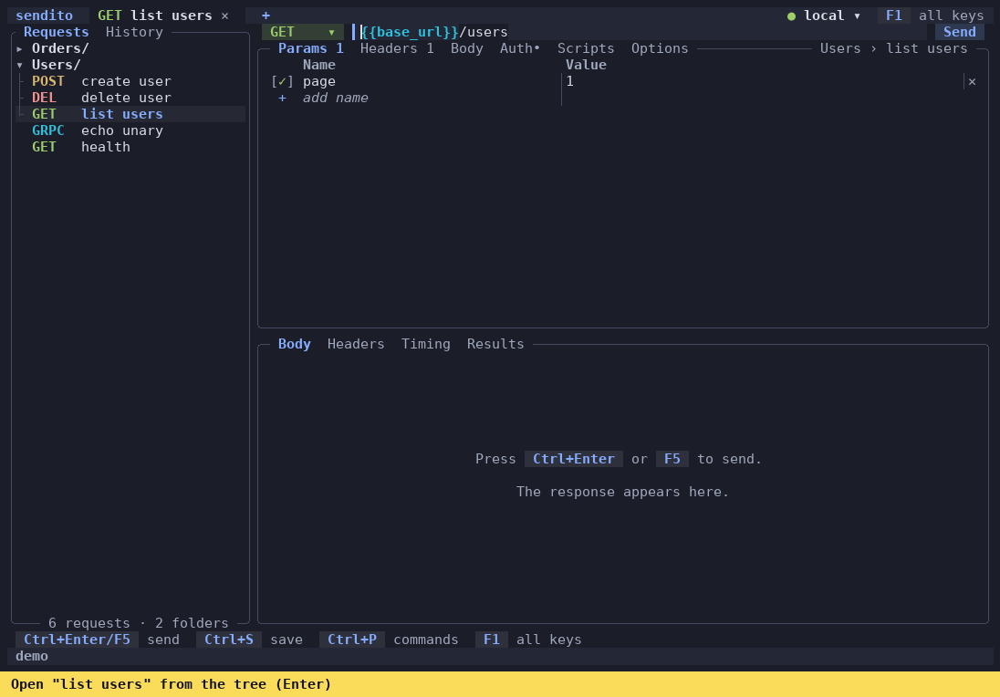 |
| **Multipart body with a file part** | 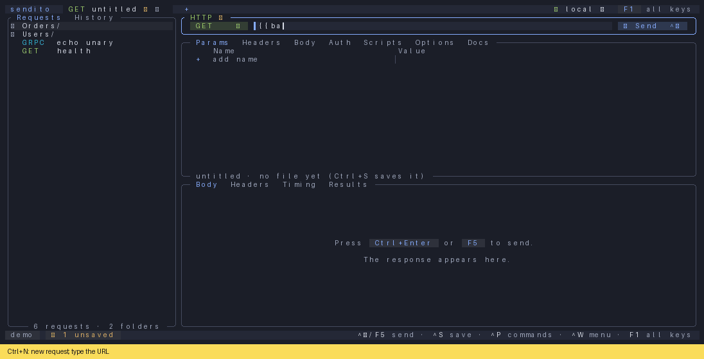 |
| **Undefined variable → switch env → send** | 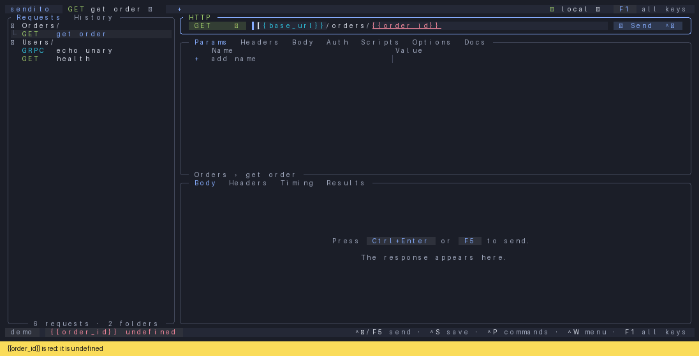 |
| **gRPC unary call via reflection** | 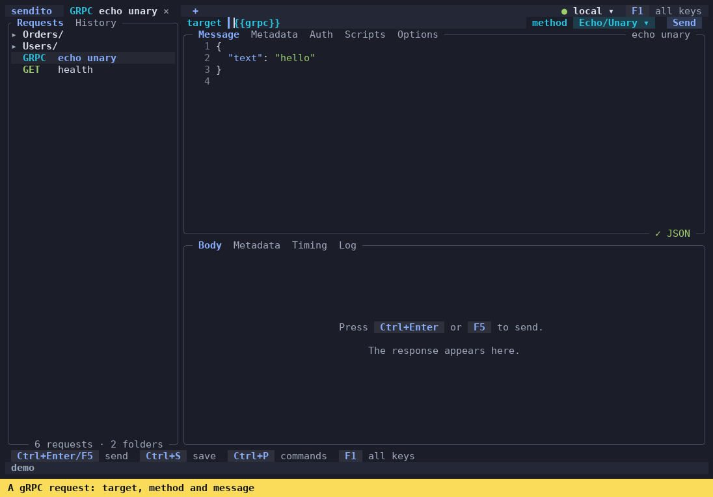 |
| **gRPC bidi stream: send, half-close** | 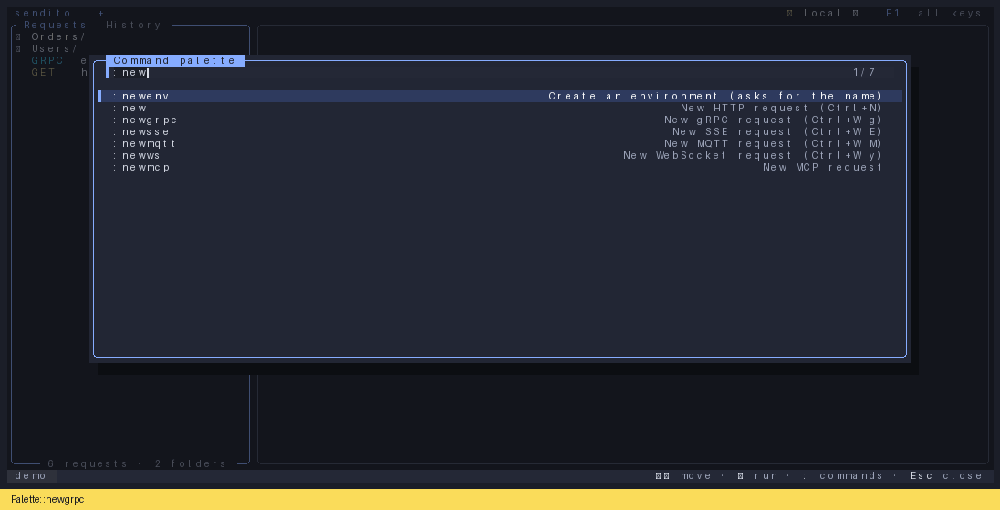 |
| **Import a Postman collection** | 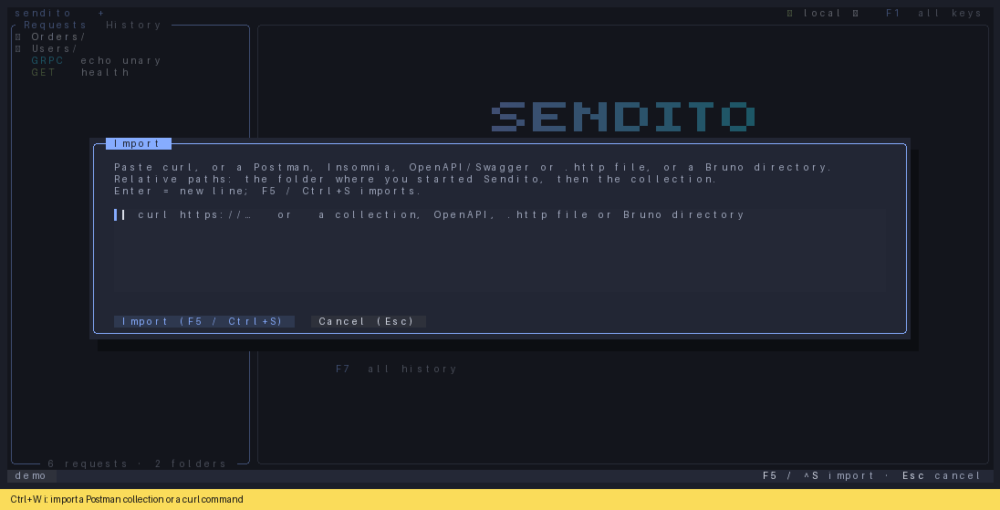 |
| **Paste curl, export as curl** | 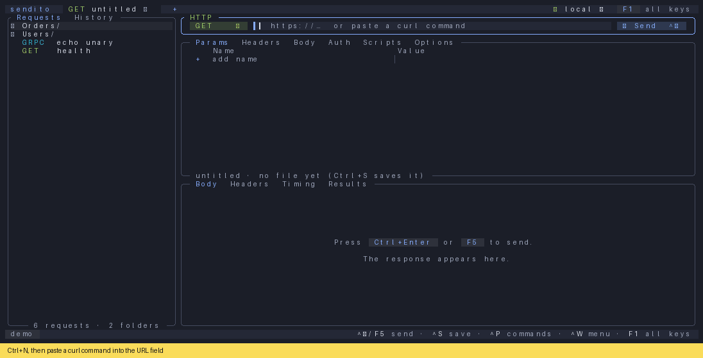 |
| **Resend from History** | 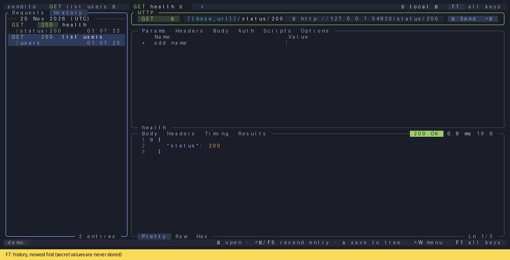 |
| **Vim mode editing** |  |
| **Drag a request into a folder** |  |
| **Errors, cancel, delete** |  |
| **An SSE session: receive events, end it** | 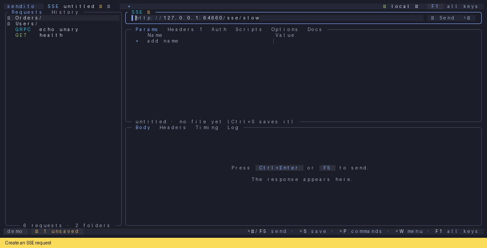 |
| **An MQTT session: subscribe, publish live, disconnect** | 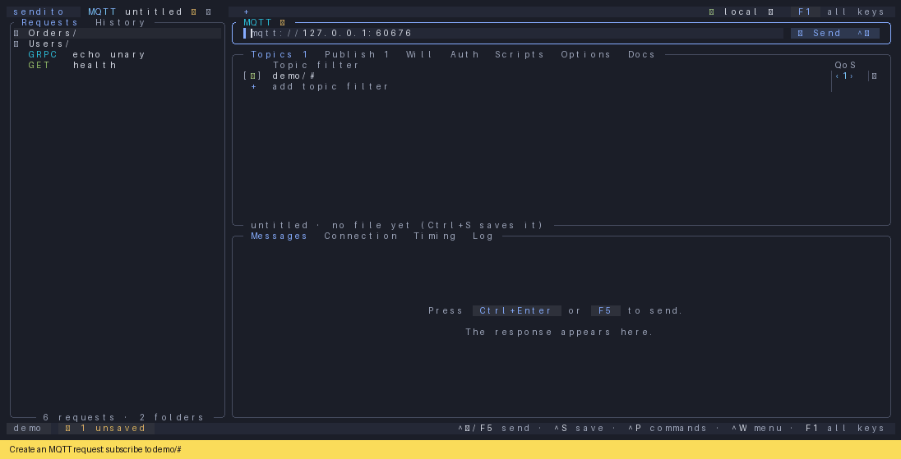 |

## Documentation

| Document | Contents |
|---|---|
| [docs/GUIDES.md](docs/GUIDES.md) | Step-by-step recipes for common tasks |
| [docs/FEATURES.md](docs/FEATURES.md) | Every feature, grouped by area |
| [docs/CLI.md](docs/CLI.md) | Every subcommand, flag, exit code, JSON report |
| [FORMAT.md](FORMAT.md) | Request / environment / config schema and wire rules |
| [KEYMAP.md](KEYMAP.md) | Every key and `:command` |
| [docs/THEMES.md](docs/THEMES.md) | Theme format and color tokens |
| [docs/TROUBLESHOOTING.md](docs/TROUBLESHOOTING.md) | Common problems and their fixes |
| [docs/DEBT.md](docs/DEBT.md) | Known limitations |
| [CHANGELOG.md](CHANGELOG.md) | Release history |

To work on Sendito, start with [docs/ARCHITECTURE.md](docs/ARCHITECTURE.md)
(crates, data flow, tests) and [AGENTS.md](AGENTS.md) (rules and `make`
targets). The [documentation index](docs/README.md) lists every document.

## License

Licensed under either of [Apache License, Version 2.0](LICENSE-APACHE) or
[MIT license](LICENSE-MIT) at your option.
