# Features

Everything Sendito does, grouped by area. Each section says where the feature
lives (key, command, flag or config table) and links to the deeper document.
Screenshots and recordings are in [media/](media/README.md).

Sendito is a terminal API client for **HTTP**, **gRPC** and **MCP tools**. It
runs locally, works with the mouse, conventional keys or vim keys, and keeps
requests as plain TOML files that you can version in git.

## At a glance

| Area | TUI | Headless CLI | Details |
|---|---|---|---|
| HTTP requests | yes | `sendito run` | [HTTP](#http) |
| gRPC calls | yes | `sendito run` | [gRPC](#grpc) |
| MCP tool calls | yes | `sendito run` | [MCP](#mcp) |
| Environments and secrets | yes | `--env`, `run` | [Variables and secrets](#variables-and-secrets) |
| Scripts (set / extract / assert) | yes | `run` | [Scripts](#scripts) |
| Collections on disk | yes | all commands | [Storage](#storage) |
| Import (Postman / Insomnia / Bruno / curl) | yes | `sendito import` | [Import and export](#import-and-export) |
| Export (curl / `.http`) | yes | `sendito curl`, `sendito http` | [Import and export](#import-and-export) |
| History | yes | `run` records it | [Storage](#storage) |
| Cookie jar | yes | `--no-cookies` | [HTTP](#http) |
| OAuth 2 (HTTP) | yes | `sendito auth` | [HTTP](#http) |
| OAuth 2.1 (MCP) | uses tokens | `sendito mcp login` | [MCP](#mcp) |
| Themes and icons | yes | `sendito theme` | [Themes and icons](#themes-and-icons) |
| Folders of requests in CI | — | `sendito run <folder>` | [Headless and CI](#headless-and-ci) |

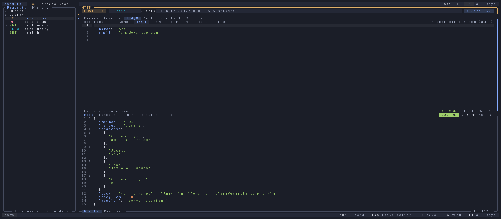

---

## HTTP

A request is one TOML file with `kind = "http"` ([FORMAT.md](../FORMAT.md#http-request)).
The wire rules are exact and spelled out in
[FORMAT.md](../FORMAT.md#what-goes-on-the-wire).

**Request**

* **Methods**: GET, POST, PUT, PATCH, DELETE, HEAD, OPTIONS, TRACE, CONNECT and
  any custom token. The method is upper-cased. In the UI the method chip opens a
  picker with a `Custom…` entry.
* **URL**: `{{variables}}` are resolved; a URL with no scheme is sent as
  `http://`. Query parameters live in their own table, are appended after any
  query already in the URL and before the fragment, and are percent-encoded by a
  documented whitelist (`,` `/` `:` `?` `@` `!` `$` `(` `)` `*` `;` stay
  literal). Disabled rows are kept in the file and not sent.
* **Headers**: rows are ordered, duplicates are preserved, and each row can be
  disabled. HTTP/1.1 sends Title-Case names; HTTP/2 lowercases them (protocol
  requirement).
* **Bodies** — one of:
  * `none`;
  * `raw` with a `content_type`;
  * `json` (sent as `application/json`);
  * `form` (`application/x-www-form-urlencoded`, `space → +`, `*-._` literal,
    everything else `%XX`);
  * `multipart` with text and file parts (filename and content type guessed from
    the extension, explicit boundary);
  * `file` (raw bytes of a path, relative to the collection root, `~/` expands).
* **Auth** — one of:
  * `none`;
  * `basic` (`Authorization: Basic base64(user:pass)`);
  * `bearer`;
  * `apikey`, sent as a header or as a query parameter;
  * `oauth`, naming an identity from `[oauth.<name>]` (authorization code +
    PKCE, tokens in the OS keychain, one refresh and retry on `401`).
* **Per-request options**: `timeout_ms`, `follow_redirects` (default on, up to
  10 hops, no `Referer` added), `verify_tls`, `cookies`.
* **Added headers** are only framing (`Host`, `Content-Length` /
  `Transfer-Encoding`), auth, a `Content-Type` derived from the body type, and
  — because the HTTP library adds it — `Accept: */*` when you define no
  `Accept`. Never a `User-Agent`, `Referer` or `Accept-Encoding`.

**Collection-level `[http]`**

| Key | Default | Effect |
|---|---|---|
| `timeout_ms` | `30000` | Default request timeout |
| `max_body_mb` | `100` | Response bodies above this are truncated (a note is shown) |
| `cookie_jar` | `false` | Default for `[options] cookies` |
| `proxy` | unset | Proxy URL or `"env"` |
| `tls` | — | Custom CA and client certificate (`[http.tls]`) |

**Proxy** (`[http] proxy`)

* A URL: `http://`, `https://`, `socks4://`, `socks4a://`, `socks5://`,
  `socks5h://`; credentials may be in the URL.
* `"env"` reads `HTTPS_PROXY` / `HTTP_PROXY` / `ALL_PROXY` / `NO_PROXY` at send
  time with curl's precedence (`HTTPS_PROXY` beats `ALL_PROXY` for `https`,
  `HTTP_PROXY` beats `ALL_PROXY` for `http`).
* Unset keeps the client's own discovery: the same variables, `NO_PROXY`
  included; the OS proxy settings are not read.
* Used by HTTP requests and MCP servers over Streamable HTTP. **gRPC does not
  use it** ([DEBT.md](DEBT.md)).

**TLS** (`[http.tls]`)

* `ca` — a PEM bundle that **replaces** the platform roots (private CAs).
* `client_cert` + `client_key` — a client certificate for mutual TLS. Defining
  one without the other warns at startup.
* Paths are relative to the collection root, `~/` expands.
* Used by HTTP, gRPC and MCP over Streamable HTTP. It is only read for TLS
  connections: a plain `http://` request never opens the files.
* Per-request `verify_tls = false` still skips server verification entirely.
* Not used by OAuth endpoints ([DEBT.md](DEBT.md)).

**Responses**

* **Decoding**: `Content-Encoding: gzip`, `deflate` (zlib with a raw fallback)
  and `br` are decompressed for display, extraction and assertions. The border
  still shows the size on the wire. Any other coding (`zstd`, stacked) or a
  truncated stream is shown as received. Sendito never sends `Accept-Encoding`,
  so it only decodes what the server chose to send.
* **Body views**: pretty JSON with folding, raw text and hex, each with line
  numbers, search and a scrollbar.
* **Timing**: DNS, TCP connect, TLS handshake, TTFB and download, with the
  remote address, the protocol and the final URL, drawn as a waterfall.
* **Headers tab**: the response headers and the request that was actually sent,
  with secrets masked.
* **Cookie jar** (opt-in): RFC 6265 with the public suffix list, stored in a
  private `0600` file with a cross-process lock and atomic replacement, isolated
  per environment. Secure cookies require HTTPS; public-suffix `Domain`
  attributes are rejected. **Redirects are not followed while the jar is
  enabled**, so a forwarded `Cookie` cannot escape its scope.

**Watch**: `Ctrl+W m` or `:watch [seconds]` re-sends the active HTTP request on
an interval (`[ui] watch_interval_s`, default 5, also in Settings). The status
line shows `↻ n s` and the Timing tab adds a sparkline. It stops on cancel, tab
close, environment change or unresolved variables, and is not written to
history.

**Folder runs**: `sendito run <folder>` sends every request below a folder in
tree order — see [Headless and CI](#headless-and-ci).

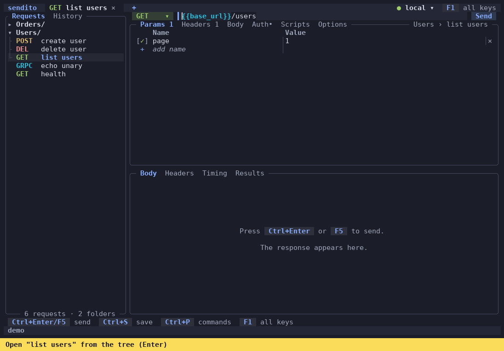


---

## gRPC

A request is one TOML file with `kind = "grpc"` ([FORMAT.md](../FORMAT.md#grpc-request)).

* **Schemas** come from **server reflection** (v1, falling back to v1alpha) or
  from `.proto` files compiled **in-process** with `protox` — no `protoc` at
  runtime. `[schema] import_paths` defaults to each file's directory.
  `:reload` re-reads the schema.
* **Call kinds**: unary, server-streaming, client-streaming and bidi, all
  through one code path.
* **Messages** are proto3 JSON (field names or JSON names; unknown fields are an
  error). The editor starts from a template generated from the schema
  (`:template`, or F2 auto-fill). For client-streaming and bidi, a JSON **array**
  sends one message per element; in the UI each further send pushes one more
  message and `Ctrl+W d` half-closes.
* **Well-known types** (`google.protobuf.*`: Timestamp, Duration, Struct,
  Value, ListValue, Empty, FieldMask, wrappers, Any) are built in.
* **Metadata**: rows are ordered, keys are lower-cased, a `-bin` key takes a
  base64 value that is decoded before sending, and auth is sent as metadata.
* **Connection**: `https://` / `grpcs://` target or `[options] tls = true` means
  TLS with ALPN `h2`; `http://` / `grpc://` means plaintext. `verify_tls` and
  `[http.tls]` material apply.
* **Deadlines**: `deadline_ms` per request, or `[grpc] deadline_ms` as the
  default; sent as `grpc-timeout` and enforced by the client.
* **Streaming control**: send more messages on an open stream, end the request
  stream (`Ctrl+W d`), cancel (`Ctrl+W x`). Every message is timestamped.
* **Log tab**: every message sent and received, with a legend (`→` sent, `←`
  received, `■` final status, `+s` seconds since the call started), the proto3
  JSON of each message (fields at their default are not on the wire and are not
  shown — assertions still see them, e.g. `$.count == 0`) and the assertion
  results.
* **Errors**: all 17 gRPC status codes are named. A non-`OK` status is exit
  code 2 from `sendito run`.
* **Not supported**: gRPC-Web, and `[http] proxy` (the tonic connector has no
  proxy support) — see [DEBT.md](DEBT.md).

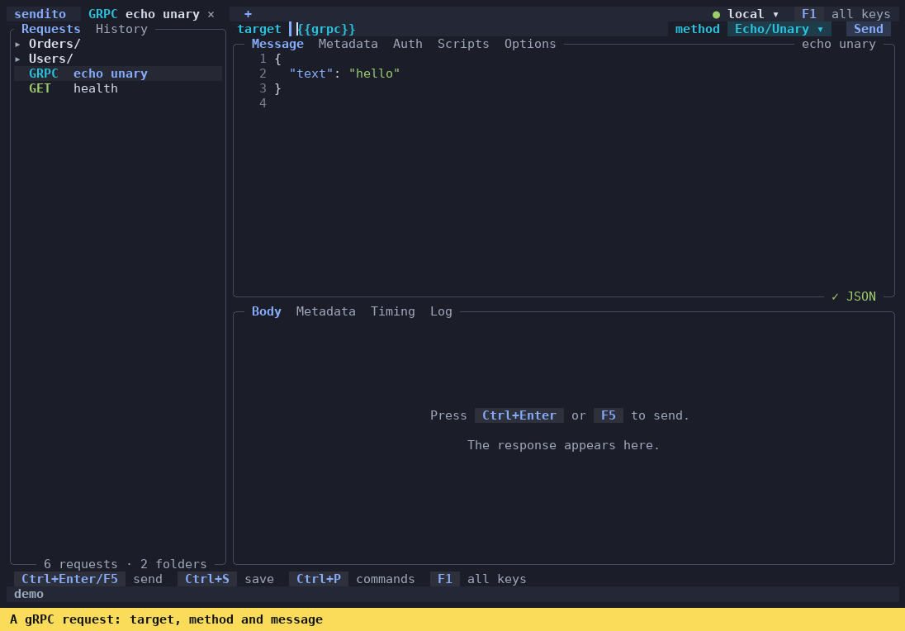

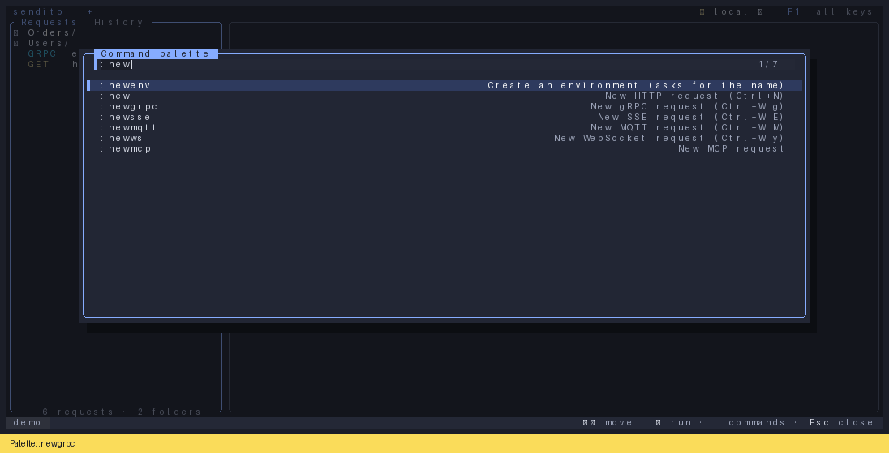

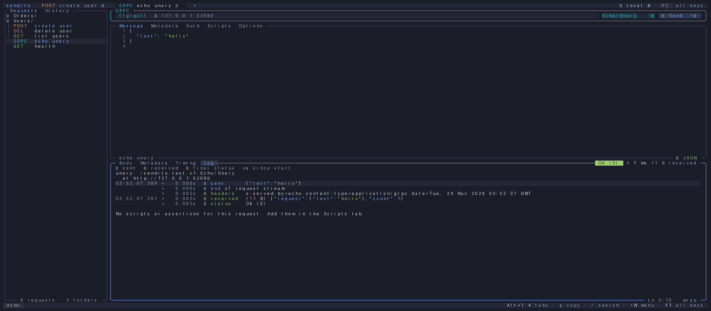

---

## MCP

An MCP request calls one tool on a server from `[mcp.servers]`
([FORMAT.md](../FORMAT.md#mcp-request)). Servers are configured, not discovered
from the request.

* **Transports**:
  * **stdio** — a child process (`command`, `args`, `env` entries added to the
    inherited environment), one UTF-8 JSON object per line on stdin/stdout,
    stderr shown in the log, killed when the request ends.
  * **Streamable HTTP** — one POST per message (`Content-Type: application/json`,
    `Accept: application/json, text/event-stream`), configured extra headers,
    `Mcp-Session-Id` and `Mcp-Protocol-Version` sent after initialization, JSON
    and SSE bodies accepted, `verify_tls` and `[http.tls]` honoured.
* **Protocol**: JSON-RPC 2.0 — `initialize`, `notifications/initialized`, then
  `tools/list` or `tools/call`. Proposed version `2025-06-18`; recognizes
  `2024-11-05`, `2025-03-26` and `2025-06-18`. `tools/list` handles cursor
  pagination.
* **Tool discovery in the UI**: F2 on the server field lists the configured
  servers; F2 on the tool field lists the tools and, when the arguments editor is
  empty or `{}`, fills an argument template from the tool's input schema.
  `:mcpservers` and `:mcptools` run the same pickers from the palette.
* **Auth**:
  * static **bearer** (`{{variables}}` allowed);
  * **OAuth 2.1** — metadata discovery (RFC 9728 / RFC 8414), PKCE, dynamic
    client registration (RFC 7591), refresh with a 30 s expiry slack, one retry
    after a `401`. Tokens live in the OS keychain under `<collection>/mcp/<server>`.
    Sign in from a shell with `sendito mcp login <server>` before calling; `:auth
    login` in the app is for HTTP OAuth identities only.
* **Results**: `isError: true` is treated as a result, not a transport failure —
  it is exit code 1 in `sendito run`. `content` items and `structuredContent` are
  visible to scripts. Tabs: **Body · Request · Timing · Log**.
* **Not supported**: resources and prompts, the legacy HTTP+SSE transport, the
  server-initiated GET stream, and non-text content is shown as JSON — see
  [DEBT.md](DEBT.md).

```toml
[mcp.servers.local]
command = "my-mcp-server"
args = ["--stdio"]

[mcp.servers.remote]
url = "https://example.com/mcp"
[mcp.servers.remote.auth]
type = "bearer"
token = "{{token}}"
```

---

## Variables and secrets

Any string field may contain `{{name}}` (spaces allowed: `{{ name }}`).

* **Lookup order, last wins**: collection variables → active environment →
  runtime variables set by scripts.
* **Nesting**: a value may contain `{{other}}`, resolved up to 8 levels; cycles
  stay unresolved.
* **Dynamic values** are generated once per send:
  `{{$uuid}}`, `{{$timestamp}}` (seconds), `{{$timestampMs}}`,
  `{{$isoTimestamp}}` (RFC 3339 UTC), `{{$randomInt}}` (0–1000).
* **Unresolved placeholders** are red in the editor and named in the status line.
  Sending asks for confirmation; `sendito run` refuses unless
  `--allow-unresolved` is given.
* **Four secret sources**, mixable in one environment:

| `source` | Value lives in | Secret |
|---|---|---|
| plain string | the environment file | no |
| `local` | `.sendito/secrets.toml` (`[<env>]`, `[_collection]`), gitignored | yes |
| `keychain` | the OS keychain (Secret Service / macOS Keychain) | yes |
| `file` | the contents of a path (one trailing newline removed) | yes |

* `key = …` selects an explicit key/account in `secrets.toml` or the keychain;
  otherwise the variable name is used.
* **Derived values inherit secrecy**: `Bearer {{token}}` and any value built from
  a secret is a secret too.
* **Masking**: the UI shows `••••••`; error messages, history and curl exports
  are scrubbed; only `:curl!` / `--include-secrets` reveal values.
* The **environment editor** (`Ctrl+W V`) edits variables in a table, writes
  secret values to their source, and shows whether each one is set.
* Environment names cannot start with `_`. `_collection` holds the
  collection-level variables' secrets.

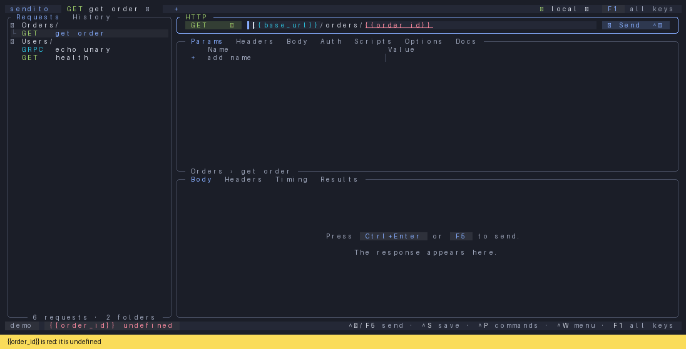


---

## Scripts

The **Scripts** tab has three declarative sections — no JavaScript
([FORMAT.md](../FORMAT.md#http-request), [DEBT.md](DEBT.md)).

* **Pre-request** (`[[scripts.pre]]`) — `var` / `value` pairs that set runtime
  variables before sending, in order, each seeing the previous.
* **Extract** (`[[scripts.extract]]`) — `var`, `from = jsonpath | header | status`,
  `expr`, and an optional `secret = true` flag. JSONPath uses `serde_json_path`;
  several matches become a JSON array, a single match becomes the unquoted
  string.
* **Assertions** (`[[scripts.assert]]`) — `from`, `expr`, `op`, `value`, with
  operators `eq`, `ne`, `contains`, `not_contains`, `exists`, `not_exists`,
  `lt`, `le`, `gt`, `ge`, `matches` (regular expression). Numeric comparison is
  numeric; otherwise string comparison.
* Results appear in the **Results** tab (gRPC: **Log**) and decide the exit code
  of `sendito run` (`1` when any assertion fails).

---

## Storage

* **One TOML file per request**, one **directory per folder**. The collection is
  a plain directory versioned in git.
* **Canonical form**: a fixed key order, defaults omitted, `'''` (or `"""`) for
  multi-line text. Re-saving an unchanged request is byte-identical and
  hand-written formatting survives until the request is edited.
* **Discovery**: the root is the nearest `.sendito/`; hidden entries and
  `[collection] ignore` directories are skipped; natural sort, folders first.
* **Session restore** (`.sendito/session.toml`, gitignored): open tabs, drafts,
  active tab and environment, layout, expanded folders and non-secret runtime
  variables.
* **History** (`.sendito/history.jsonl`, gitignored): one JSON object per sent
  request, the request as written with `{{variables}}` (no bodies), trimmed at
  `[history] max_entries` (default 10 000) plus 10 % slack.
* **Cookie jar** (`.sendito/cookies.toml`, gitignored) and its lock file.
* `sendito init` writes the `.gitignore` entries for all the local files.

Full schema and the directory diagram: [FORMAT.md](../FORMAT.md).

---

## Import and export

**Import** — `Ctrl+W i`, `:import [path]` or `sendito import <file|dir>`
(`--into <folder>` to import into a subfolder):

* **Postman Collection v2.1** — folders, requests (method, URL, query, headers,
  every body mode, basic / bearer / API-key auth with inheritance), collection
  variables, dynamic-variable aliases. Scripts, saved examples, OAuth 2, Digest
  and descriptions are **reported**, not converted.
* **Insomnia v4/v5** — folders, supported HTTP requests, selectable
  environments, `{{ _.name }}` templates where expressible. Private
  environments are not imported.
* **Bruno directory** — folders, supported HTTP requests, environments; secret
  variables are reported.
* **curl paste** — paste a `curl …` command into the URL field or the import
  dialog. Supported flags include `-X -H -d --data-* -F/--form/--form-string
  -u -A -e -b -G -I -L -k -m --url --json --compressed --http* -x`. curl
  semantics are reproduced: `-H 'Name:'` becomes a disabled row, `-H 'Name;'`
  an empty value.
* The import **report dialog** groups items as Needs action / Skipped /
  Imported with changes; `y` copies it and `:report` reopens it.

**Export**:

* **curl** — `Ctrl+W u` / `:curl` or `sendito curl <request>`. Secret variables
  stay `{{placeholders}}`; `:curl!` / `--include-secrets` include them.
* **`.http`** — `:httpfile` or `sendito http <request>` produces a JetBrains
  HTTP client / VS Code REST Client block: `### name`, `# @timeout`,
  `# @no-redirect`, headers, body (`< path` for a file body, an explicit
  multipart boundary). Basic auth with unresolved credentials uses
  `{{sendito_basic_credentials}}` (base64 of `user:password`).

Import gaps are listed in [DEBT.md](DEBT.md).

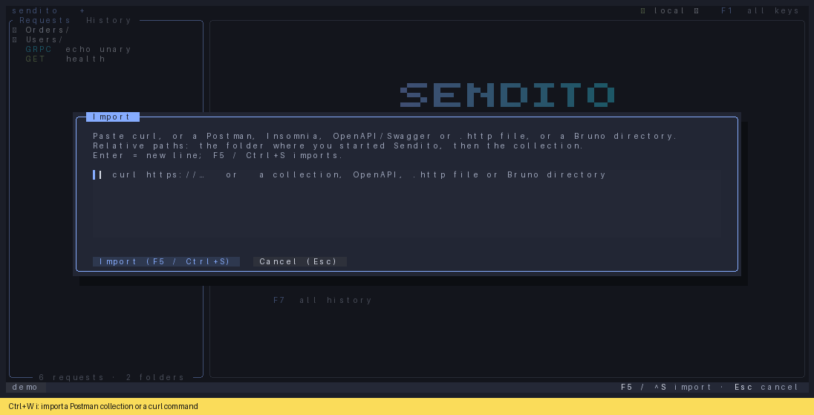

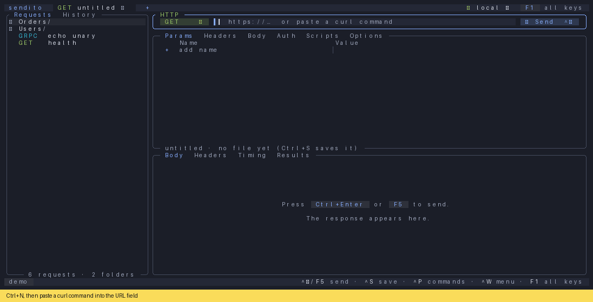

---

## TUI

* **Top bar**: the brand, the open requests as tabs (`●` unsaved, a spinner
  while running, `+` new), the environment chip and `F1 all keys`. The
  environment chip is coloured by name: `prod`/`live` red,
  `staging`/`qa`/`test`/`uat` yellow, `local`/`dev` green.
* **URL strip**: above both panes — method chip, URL with `{{variables}}`
  highlighted, and **Send** (for gRPC: target and method).
* **Sidebar**: **Requests** (the tree, with `├ └` connectors, open-in-tab
  accent, filter with `/`, request and folder counts) or **History** (grouped
  by day, status in colour). It can sit on the right and be resized.
* **Request tabs**: HTTP `Params · Headers · Body · Auth · Scripts · Options`;
  gRPC `Message · Metadata · Auth · Scripts · Options`; MCP
  `Tool · Args · Scripts · Options`. The request's folder path is on the right;
  a tab shows its row count or `•` when set; editors have line numbers and JSON
  shows `✓ JSON` / `✗ JSON: line, col` plus `Ln, Col`.
* **Response tabs**: HTTP `Body · Headers · Timing · Results`; gRPC
  `Body · Metadata · Timing · Log`; MCP `Body · Request · Timing · Log`.
* **Start screen** (no tab open): a pixel wordmark, a collection summary, the
  getting-started keys and the most recent requests (click one to open).
* **Hint row** (context key caps) and **status line** (vim mode, unsaved count,
  undefined variables, watch state, running/stream state, messages).
* **Overlays** over a dimmed backdrop: command palette, help (searchable, two
  columns at ≥ 180 columns), settings, confirm questions, prompts, fuzzy
  pickers (environment, method, gRPC service/method, MCP server/tool, move-to-
  folder), the environment editor, the import dialog and the report dialog.
* **Layout**: panes resize with the mouse or `Ctrl+W <`/`>` and `Ctrl+W +`/`-`;
  `Ctrl+W z` maximises the focused pane; `Ctrl+B` hides the sidebar. Below
  40×8 a message replaces the layout; 120×40 and 200×60 are the tested sizes.

**Command palette** (`Ctrl+P` or `:`): actions with their keys, all requests,
all environments, and the `:commands`.

| Command | Does |
|---|---|
| `:send` | Send the current request |
| `:cancel` | Cancel the running request |
| `:watch [seconds]` | Repeat the active HTTP request on an interval |
| `:end` | Finish sending on a client/bidi stream |
| `:env <name>` | Switch environment |
| `:envs` | Edit environments |
| `:auth login <identity>` / `:auth logout <identity>` | HTTP OAuth sign in / out |
| `:w`, `:saveas <name>`, `:wq`, `:q`, `:q!` | Save / save as / save and quit / quit / quit without saving |
| `:new`, `:newgrpc`, `:newmcp` | New HTTP / gRPC / MCP request |
| `:mcpservers`, `:mcptools` | Choose an MCP server / discover and choose a tool |
| `:import [path]` | Import a collection or paste curl |
| `:curl`, `:curl!`, `:httpfile`, `:httpfile!` | Export (without / with secrets) |
| `:cookies`, `:cookies clear`, `:cookies delete <n>` | Manage the cookie jar |
| `:history`, `:clearhistory` | Show / clear history |
| `:format` | Pretty-print the JSON body |
| `:template`, `:reload` | Fill a gRPC message from the schema / reload the schema |
| `:settings`, `:theme <name>`, `:theme reload`, `:help` | Settings / theme / help |
| `:report`, `:savebody [path]` | Reopen the last report / save the response body |

**Mouse**: click to focus, select rows, switch and close tabs (middle-click
closes too) and press buttons; double-click opens a request; drag a tree item
onto a folder to move it; drag pane borders to resize; the wheel scrolls the
pane under the pointer.

**Vim mode** (`[ui] vim_mode` or Settings): modal editors (normal / insert /
visual / visual-line) with `hjkl`, `w b e`, `0 ^ $`, `gg G`,
`x dd D cc C yy p P u Ctrl+R`, `v V` then `d y c`; `:` opens the palette in
command mode. The tree and the response viewer use `hjkl`, `gg`/`G` and `/`.
The status line shows the mode.

Every key is in [KEYMAP.md](../KEYMAP.md), generated from the same table as the
in-app help, and can be remapped in `[keymap.all]`, `[keymap.conventional]` or
`[keymap.vim]`.

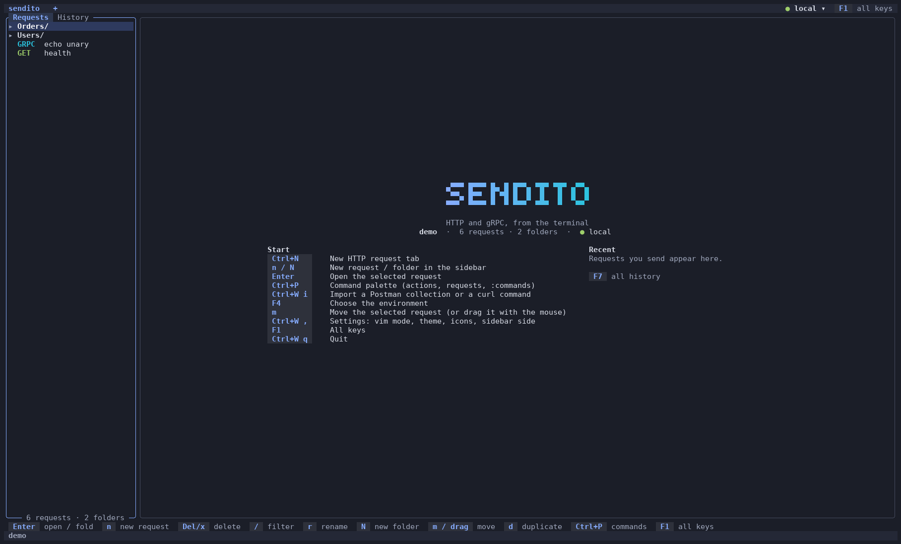


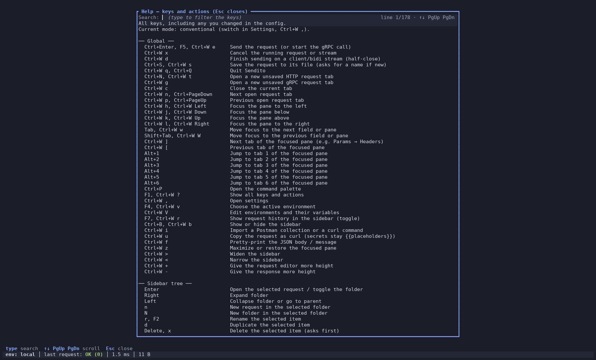

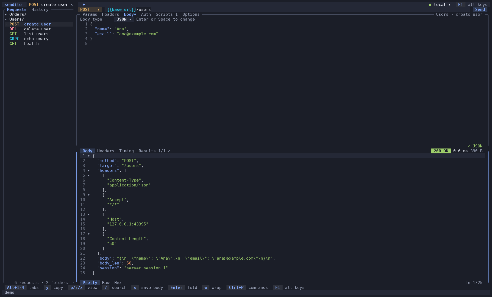

---

## Settings

`Ctrl+W ,` or `:settings`. Changes take effect at once and are written to the
global config.

| Setting | Config key | Effect |
|---|---|---|
| Theme | `ui.theme` | Colors; `auto` follows the terminal background |
| Icons | `ui.icons` | `unicode` (any font) or `nerd` (needs a Nerd Font) |
| Vim mode | `ui.vim_mode` | Modal editing in editors and lists |
| Sidebar position | `ui.sidebar` | `left` or `right` |
| Mouse support | `ui.mouse` | Clicks, wheel, dragging tree items and borders |
| Confirm quit with unsaved changes | `ui.confirm_quit` | Ask before quitting with unsaved tabs |
| Record history | `history.enabled` | Keep sent requests in History |
| Watch interval | `ui.watch_interval_s` | Default seconds between watch re-sends |

---

## Headless and CI

`sendito run` sends a request without the UI, or a whole folder.

* **One request**: the body goes to stdout; status, timing and assertion
  results to stderr. `-i` adds the response headers to stderr.
* **A folder** (or `.`): every request below it, in tree order, one
  `PASS`/`FAIL`/`ERROR` line each and a summary. **Variables a request extracts
  are carried forward**, so a login and its dependent calls run as one command.
  `--fail-fast` stops at the first failure; `--report json` prints a structured
  summary to stdout; `--no-history` and `--no-cookies` control history and the
  cookie jar for the run.
* **Exit codes**: `0` success, `1` a failed assertion or an MCP `isError`, `2`
  the request failed, `3` usage or unresolved variables. A folder run returns
  the worst code.
* Use `--env <name>` to pick the environment. `--allow-unresolved` sends even
  with unresolved placeholders.

```sh
sendito run "Users/list users" --env local      # body to stdout, status to stderr
sendito run Users --env local                   # every request under Users
sendito run . --env local --report json         # the current folder, JSON summary
sendito run checks/health --fail-fast --env prod
```

The flags and the JSON shape are in [CLI.md](CLI.md#sendito-run-request).

---

## Themes and icons

Seven built-in themes: `auto`, `dusk`, `daylight`, `ember`, `linen`, `contrast`
and `ansi` (the terminal's own 16 colors). `NO_COLOR=1` turns colors off.
Terminals without 24-bit color get the nearest of 256.

* Your own themes are TOML files in `~/.config/sendito/themes/` or
  `<collection>/.sendito/themes/`; a theme can `extends` another and set only
  some colors. Derived colors are recomputed from the base colors, so changing
  `bg` alone gives a consistent theme.
* `sendito theme list` shows every theme, its file and any problems;
  `sendito theme print <name>` prints a complete file to start from;
  `:theme <name>` applies one and `:theme reload` re-reads the files.
* Problems (unknown token, bad color, an `extends` loop, low contrast) are
  reported and skipped; they never stop startup.
* **Icons** `unicode` (works with any font) or `nerd` (folders, sidebar modes,
  environment, Send and status icons, rounded chip ends).

The full token list is in [THEMES.md](THEMES.md).

| dusk | daylight |
|---|---|
| 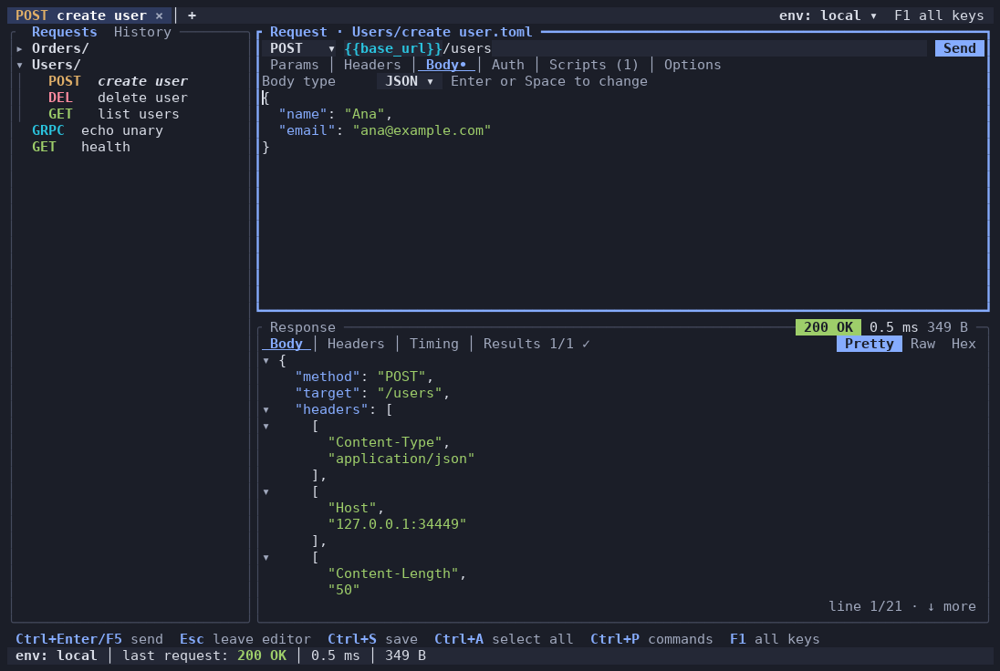 |  |
| **ember** | **linen** |
| 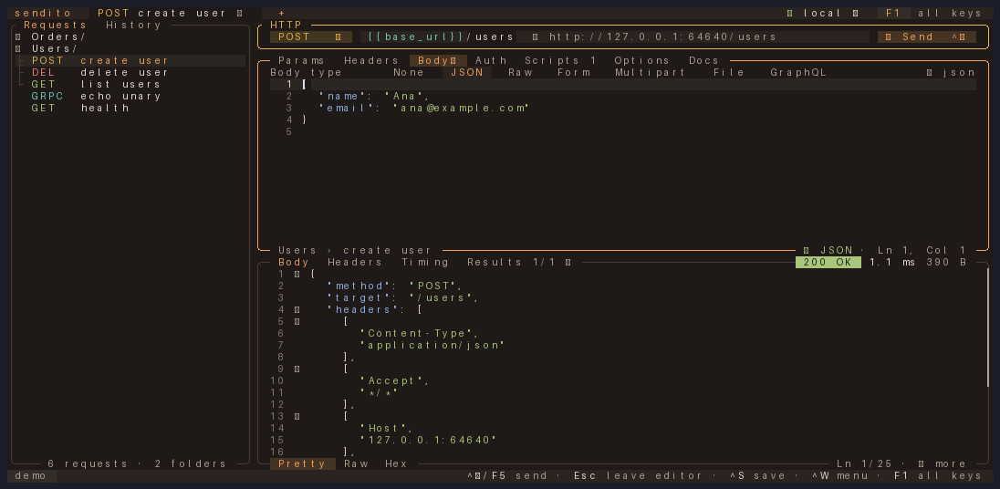 | 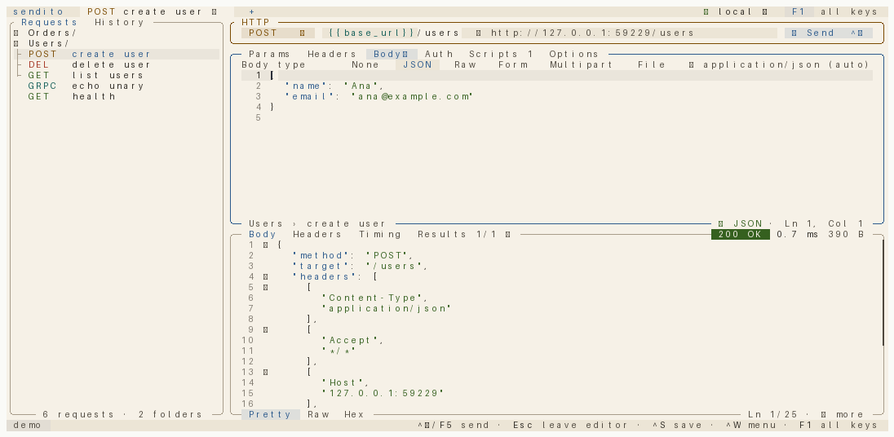 |
| **contrast** | **ansi** |
| 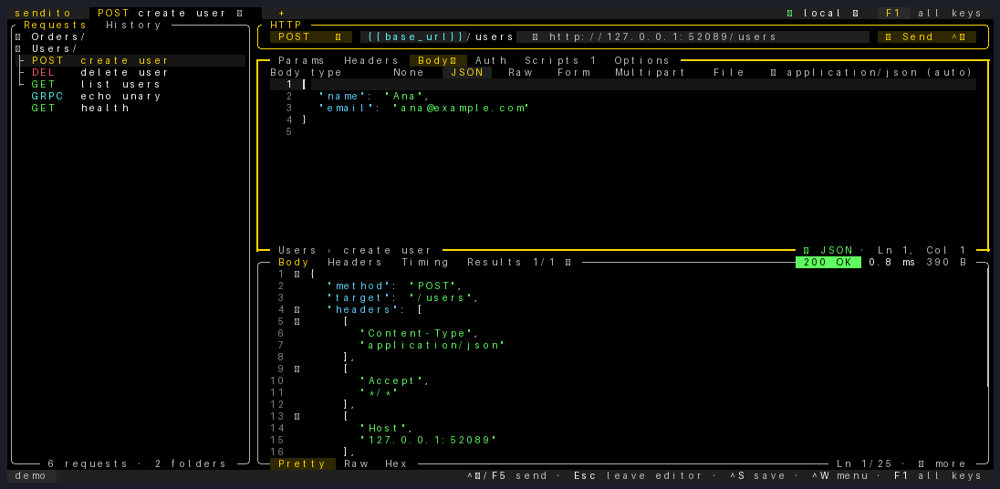 |  |

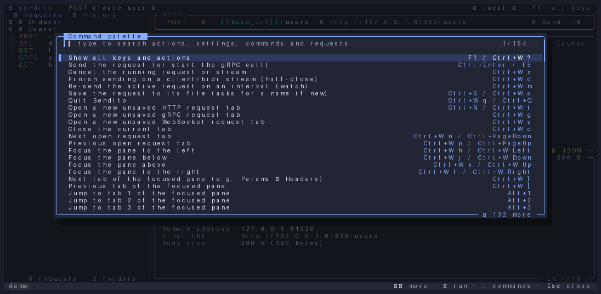

---

## Known limits

The full list with remediation plans is in [DEBT.md](DEBT.md). The ones worth
knowing up front:

* HTTP library differences: `Accept: */*` is added when you define none, HTTP/1
  header names go out Title-Case, and header order between different names may
  differ.
* No JavaScript scripts; no HTTP/3 or WebSocket; no gRPC-Web.
* gRPC ignores `[http] proxy`; OAuth endpoints ignore `[http.tls]` and the proxy.
* Redirects are not followed while the cookie jar is enabled.
* `zstd` and stacked `Content-Encoding` are shown as received.
* MCP: tools only (no resources or prompts), a session per list/call, no legacy
  HTTP+SSE and no server GET stream.
* Windows is not a target.

---

## Coverage checklist

Where each part of the surface is written down, so a gap is visible in one
place. `—` means it is described only here.

| Surface | TUI | CLI | Format | Keys |
|---|---|---|---|---|
| HTTP request fields | [HTTP](#http) | [CLI run](CLI.md#sendito-run-request) | [FORMAT §HTTP](../FORMAT.md#http-request) | — |
| HTTP wire rules | [HTTP](#http) | — | [FORMAT §wire](../FORMAT.md#what-goes-on-the-wire) | — |
| Proxy | [HTTP](#http) | — | [FORMAT §config](../FORMAT.md#project-and-global-config) | — |
| TLS / mTLS | [HTTP](#http) | — | [FORMAT §config](../FORMAT.md#project-and-global-config) | — |
| Cookie jar | [HTTP](#http) | [`--no-cookies`](CLI.md#sendito-run-request) | [FORMAT §jar](../FORMAT.md#cookie-jar) | `:cookies` |
| Watch | [HTTP](#http) | — | `ui.watch_interval_s` | `Ctrl+W m`, `:watch` |
| gRPC | [gRPC](#grpc) | [CLI run](CLI.md#sendito-run-request) | [FORMAT §gRPC](../FORMAT.md#grpc-request) | `Ctrl+W d` |
| MCP | [MCP](#mcp) | [CLI mcp](CLI.md#sendito-mcp-login-server--logout) | [FORMAT §MCP](../FORMAT.md#mcp-request) | F2, `:mcptools` |
| MCP / HTTP OAuth | [MCP](#mcp) | [CLI auth](CLI.md#sendito-auth-login-identity--logout) | [FORMAT §config](../FORMAT.md#project-and-global-config) | `:auth login` |
| Variables and secrets | [Variables](#variables-and-secrets) | [`--env`](CLI.md#sendito-run-request) | [FORMAT §vars](../FORMAT.md#variables) | `F4`, `Ctrl+W V` |
| Scripts | [Scripts](#scripts) | [CLI run](CLI.md#sendito-run-request) | [FORMAT §HTTP](../FORMAT.md#http-request) | — |
| Import | [Import](#import-and-export) | [CLI import](CLI.md#sendito-import-file-or-directory) | — | `Ctrl+W i` |
| Export | [Import](#import-and-export) | [CLI curl/http](CLI.md#sendito-curl-request) | — | `Ctrl+W u`, `:httpfile` |
| History / session | [Storage](#storage) | [`--no-history`](CLI.md#sendito-run-request) | [FORMAT §state](../FORMAT.md#local-state-files) | `F7` |
| Theme / icons | [Themes](#themes-and-icons) | [CLI theme](CLI.md#sendito-theme-list--print) | [THEMES](THEMES.md) | `:theme` |
| Settings | [Settings](#settings) | — | [FORMAT §config](../FORMAT.md#project-and-global-config) | `Ctrl+W ,` |
| Folder runs | [Headless](#headless-and-ci) | [CLI run](CLI.md#sendito-run-request) | — | — |
| Mouse / vim | [TUI](#tui) | — | — | [KEYMAP](../KEYMAP.md) |
| Exit codes | — | [CLI codes](CLI.md#exit-codes) | — | — |
| Hidden flags | — | [CLI internal](CLI.md#internal-flags-hidden) | — | — |

---

## Documentation map

| Document | Answers |
|---|---|
| [README](../README.md) | What it is, install, quick start, gallery |
| [FORMAT.md](../FORMAT.md) | Request, environment and config files; exact wire rules |
| [KEYMAP.md](../KEYMAP.md) | Every key, generated |
| [CLI.md](CLI.md) | Every subcommand, flag, exit code |
| [ARCHITECTURE.md](ARCHITECTURE.md) | Crates, data flow, tests, extending |
| [THEMES.md](THEMES.md) | Theme format and color tokens |
| [DEBT.md](DEBT.md) | Known limitations |
| [media/README.md](media/README.md) | Screenshots and GIFs |
| [docs index](README.md) | Everything above, in one table |
