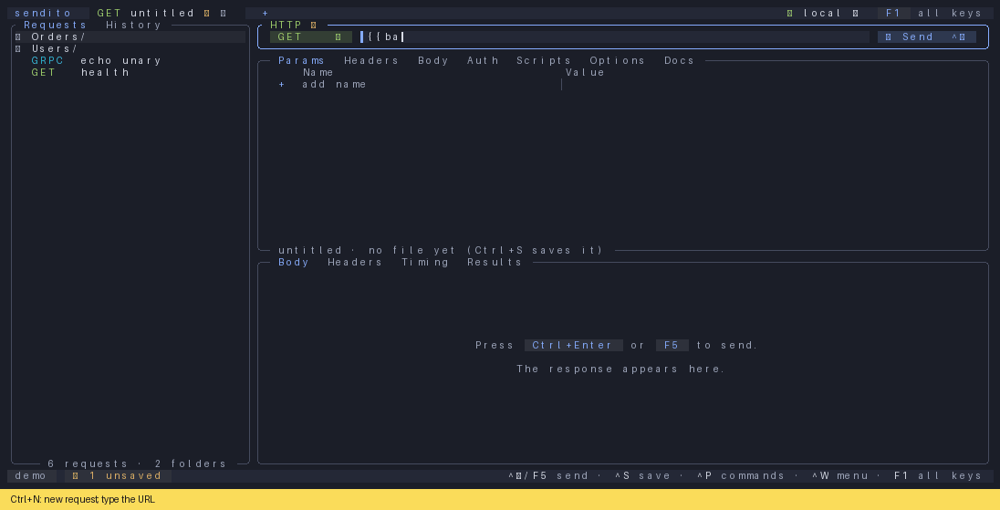
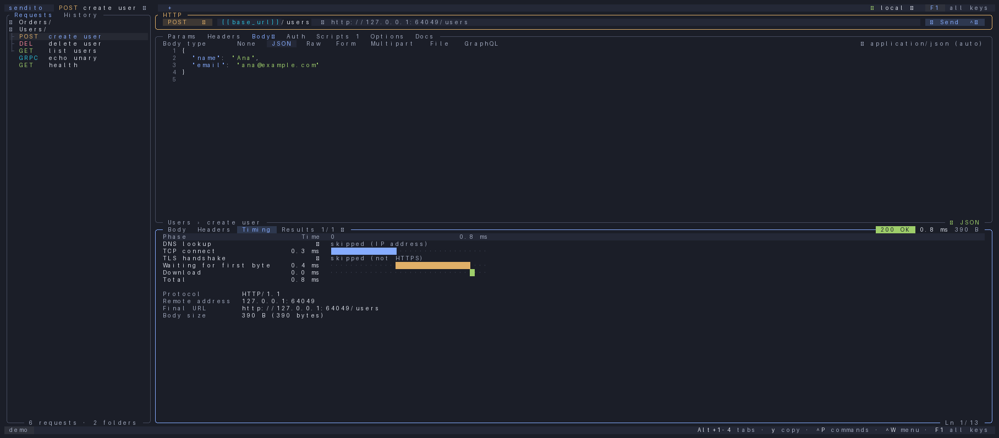
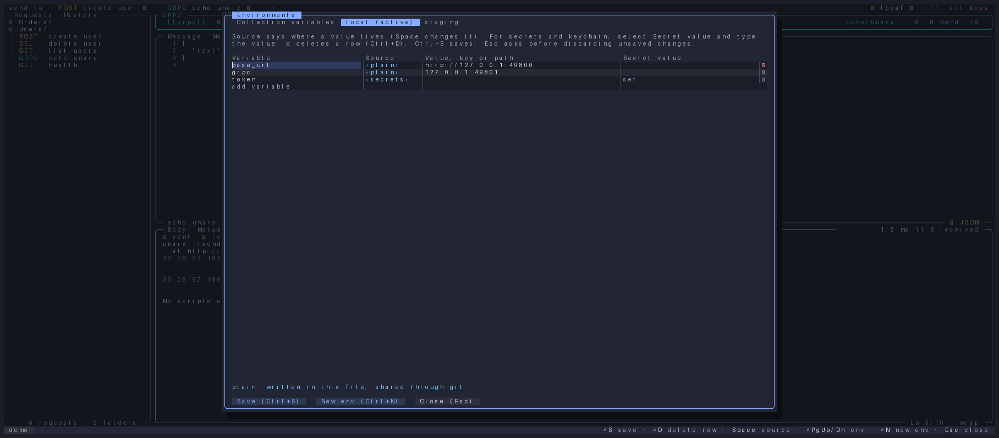
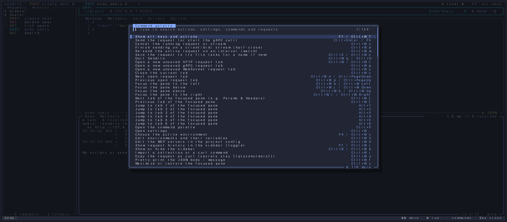
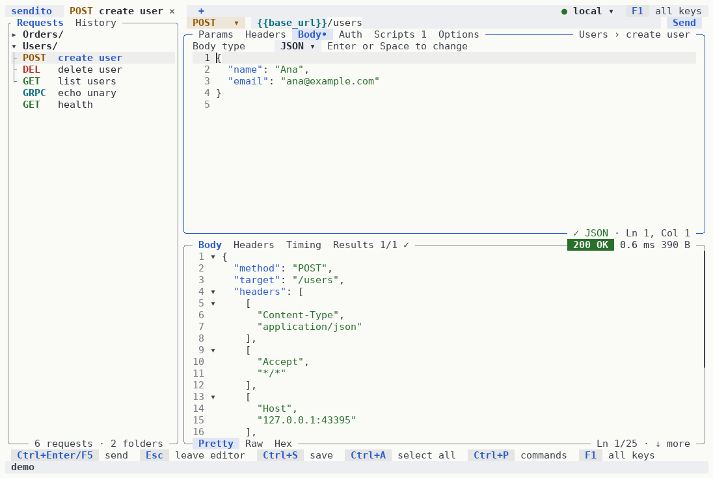
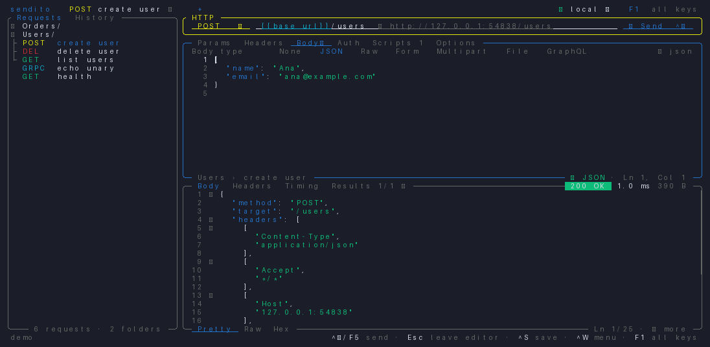

# Features

Everything Sendito does, grouped by area. Each section says where the feature
lives (key, command, flag or config table) and links to the deeper document.
Screenshots and recordings are in [media/](media/README.md).

Sendito is a terminal API client for **HTTP**, **gRPC**, **WebSocket**,
**SSE**, **MQTT** and **MCP tools**. It runs locally, works with the mouse, conventional keys or vim keys, and keeps
requests as plain TOML files that you can version in git.

## At a glance

| Area | TUI | Headless CLI | Details |
|---|---|---|---|
| HTTP requests | yes | `sendito run` | [HTTP](#http) |
| gRPC calls | yes | `sendito run` | [gRPC](#grpc) |
| SSE sessions | yes | `sendito run` | [SSE](#sse) |
| MQTT sessions | yes | `sendito run` | [MQTT](#mqtt) |
| WebSocket sessions | yes | `sendito run` | [WebSocket](#websocket) |
| MCP tool calls | yes | `sendito run` | [MCP](#mcp) |
| Environments and secrets | yes | `--env`, `run` | [Variables and secrets](#variables-and-secrets) |
| Scripts (set / extract / assert) | yes | `run` | [Scripts](#scripts) |
| Collections on disk | yes | all commands | [Storage](#storage) |
| Folder settings (inherited headers, auth, variables, scripts) | yes | `run`, exports | [Folder settings](#folder-settings) |
| Saved example responses | yes | — | [Saved examples](#saved-examples) |
| Descriptions (Markdown, per request and folder) | yes | — | [Descriptions](#descriptions) |
| Import (Postman / Insomnia / Bruno / OpenAPI / `.http` / HAR / curl) | yes | `sendito import` | [Import and export](#import-and-export) |
| Export (curl / `.http` / code / HAR) | yes | `sendito curl`, `sendito http`, `sendito code`, `sendito har` | [Import and export](#import-and-export) |
| History | yes | `run` records it | [Storage](#storage) |
| Cookie jar | yes | `--no-cookies` | [HTTP](#http) |
| OAuth 2 (HTTP) | yes | `sendito auth` | [HTTP](#http) |
| OAuth 2.1 (MCP) | yes | `sendito mcp login` | [MCP](#mcp) |
| Themes and icons | yes | `sendito theme` | [Themes and icons](#themes-and-icons) |
| Folders of requests in CI | — | `sendito run <folder>` | [Headless and CI](#headless-and-ci) |


---

## HTTP

A request is one TOML file with `kind = "http"` ([FORMAT.md](../FORMAT.md#http-request)).
The wire rules are exact and spelled out in
[FORMAT.md](../FORMAT.md#what-goes-on-the-wire).

**Request**

* **Methods**: GET, POST, PUT, PATCH, DELETE, HEAD, OPTIONS, TRACE, CONNECT and
  any custom token. The method is upper-cased. In the UI the method chip opens a
  picker with a `Custom…` entry.
* **URL**: `{{variables}}` are resolved; a URL with no scheme is sent as
  `http://`. Query parameters live in their own table, are appended after any
  query already in the URL and before the fragment, and are percent-encoded by a
  documented whitelist (`,` `/` `:` `?` `@` `!` `$` `(` `)` `*` `;` stay
  literal). Disabled rows are kept in the file and not sent.
* **Headers**: rows are ordered, duplicates are preserved, and each row can be
  disabled. HTTP/1.1 sends Title-Case names; HTTP/2 lowercases them (protocol
  requirement).
* **Bodies** — one of:
  * `none`;
  * `raw` with a `content_type`;
  * `json` (sent as `application/json`);
  * `graphql`: separate Query, Variables and Operation name editors. Sends a JSON
    object with `query`, optional `variables` and optional `operationName`.
    Variables must be a JSON object. Postman and Bruno GraphQL imports keep
    these fields separate. `:graphqlschema` loads introspection in the background.
    It uses the request's auth, cookies, TLS and proxy settings. The Query editor
    completes fields, unused arguments (`name: `) and inline-fragment types.
    It skips fields already selected at that level. Completion loads a missing
    schema in the background. A failed load requires `:graphqlschema` to retry.
    Query parsing is heuristic, not GraphQL validation;
  * `form` (`application/x-www-form-urlencoded`, `space → +`, `*-._` literal,
    everything else `%XX`);
  * `multipart` with text and file parts (filename and content type guessed from
    the extension, explicit boundary);
  * `file` (raw bytes of a path, relative to the collection root, `~/` expands).
* **Auth** — one of:
  * `inherit` (the default: the auth of the nearest folder that sets one, see
    [Folder settings](#folder-settings));
  * `none`;
  * `basic` (`Authorization: Basic base64(user:pass)`);
  * `bearer`;
  * `apikey`, sent as a header or as a query parameter;
  * `oauth`, naming an identity from `[oauth.<name>]` (tokens in the OS
    keychain, one refresh and retry on `401`). The grant is authorization code
    + PKCE (a browser sign-in), device code (a code to enter on another
    device), or client credentials / password (no sign-in: a token is
    requested when a request needs one, also in CI);
  * `digest` (RFC 7616: SHA-256 or MD5, `qop=auth`; the first send gets the
    server's challenge and the request is sent once more with the answer);
  * `awsv4` (AWS Signature Version 4 over the request as it is sent: access
    key, secret key, optional session token, region, service; not for a
    multipart body);
  * `jwt` (a JWT signed at send time from the claims: HS256/384/512 with a
    secret, RS256/ES256 with a PEM key file; `expires_in_s` adds `iat` and
    `exp`; also for gRPC and WebSocket).
* **Per-request options**: `timeout_ms`, `follow_redirects` (default on, up to
  10 hops, no `Referer` added; authentication stays behind on a redirect to
  another origin), `verify_tls`, `cookies`.
* **Added headers** are only framing (`Host`, `Content-Length` /
  `Transfer-Encoding`), auth, a `Content-Type` derived from the body type, and
  — because the HTTP library adds it — `Accept: */*` when you define no
  `Accept`. Never a `User-Agent`, `Referer` or `Accept-Encoding`.

**Collection-level `[http]`**

| Key | Default | Effect |
|---|---|---|
| `timeout_ms` | `30000` | Default request timeout |
| `max_body_mb` | `100` | Response bodies above this are truncated (a note is shown) |
| `cookie_jar` | `false` | Default for `[options] cookies` |
| `proxy` | unset | Proxy URL or `"env"` |
| `tls` | — | Custom CA and client certificate (`[http.tls]`) |

**Proxy** (`[http] proxy`)

* A URL: `http://`, `https://`, `socks4://`, `socks4a://`, `socks5://`,
  `socks5h://`; credentials may be in the URL.
* `"env"` reads `HTTPS_PROXY` / `HTTP_PROXY` / `ALL_PROXY` / `NO_PROXY` at send
  time with curl's precedence (`HTTPS_PROXY` beats `ALL_PROXY` for `https`,
  `HTTP_PROXY` beats `ALL_PROXY` for `http`).
* Unset keeps the client's own discovery: the same variables, `NO_PROXY`
  included; the OS proxy settings are not read.
* Used by HTTP requests and MCP servers over Streamable HTTP. **gRPC does not
  use it** ([DEBT.md](DEBT.md)).

**TLS** (`[http.tls]`)

* `ca` — a PEM bundle that **replaces** the platform roots (private CAs).
* `client_cert` + `client_key` — a client certificate for mutual TLS. Defining
  one without the other warns at startup.
* Paths are relative to the collection root, `~/` expands.
* Used by HTTP, gRPC and MCP over Streamable HTTP. It is only read for TLS
  connections: a plain `http://` request never opens the files.
* Per-request `verify_tls = false` still skips server verification entirely.
* Not used by OAuth endpoints ([DEBT.md](DEBT.md)).

**Responses**

* **Decoding**: `Content-Encoding: gzip`, `deflate` (zlib with a raw fallback)
  and `br` are decompressed for display, extraction and assertions. The border
  still shows the size on the wire. Any other coding (`zstd`, stacked) or a
  truncated stream is shown as received. Sendito never sends `Accept-Encoding`,
  so it only decodes what the server chose to send.
* **Body views**: pretty, raw text and hex, each with line numbers, search
  and a scrollbar. In the pretty view the bottom border shows the jq path of
  the line at the cursor (`.items[0].email`): `f` filters the body to that
  value and `Y` copies the path (JSON only).
* **Copy**: `y` and `Ctrl+W u` copy through the terminal clipboard (OSC 52).
  In tmux, enable it with `set -g set-clipboard on`.
* **Pretty formats**: the Content-Type chooses the format; with none that
  names one, a body that starts with `{` or `[` is JSON, `<?xml` is XML and
  `<!doctype html` or `<html` is HTML. YAML and CSV need their Content-Type.
  A body that does not parse in its format shows raw.
  * **JSON**: re-indented, highlighted, a fold per object and array.
  * **XML** (`xml`, `+xml`): one tag per line, two spaces per level, a fold
    per element. Text, comments and CDATA keep their bytes. Closing tags that
    do not match show the body raw.
  * **HTML** (`text/html`, `xhtml`): the same layout. `br`, `img` and the
    other void elements open no level; the content of `pre`, `script`,
    `style` and `textarea` shows as received; an element left open (`<p>`,
    `<li>`) ends before the closing tag of its parent.
  * **YAML** (`yaml`, `yml`): the text as received (comments, anchors, key
    order), highlighted, a fold per indented block.
  * **CSV and TSV** (`text/csv`, `text/tab-separated-values`): aligned
    columns with a bold header row; a line break in a cell shows as `⏎`.
    Bodies larger than 10 MB, or with rows of different lengths, show raw.
* **Query bar**: `/` (search) and `j` (vim `J`, jq filter) open a bar on the
  first row of the response view; there is no dialog. The view follows the
  text as you type. On the right the bar shows `2 results`, `match 3/12`,
  `no match` or the jq error in red; with an error the body keeps the last
  valid result. Enter keeps the text and goes back to the view (the bar stays
  while a filter applies); Esc goes back to the text the last Enter kept; an
  empty text closes the bar. In the jq bar, Tab completes an object key after
  `.` from the keys the body really has (one match goes in at once, more open
  a list with the type of each value), and Up/Down walk the expressions used
  in the tab (the last 50, kept in memory only). A body larger than 1 MB is
  filtered when Enter is pressed, not at each key.
* **Timing**: DNS, TCP connect, TLS handshake, TTFB and download, with the
  remote address, the protocol and the final URL, drawn as a waterfall.
* **jq filter**: the jq bar or `:jq [expr]` filters the JSON body with a jq
  expression (the `jaq` library): paths, pipes, `select`, `map`, slicing,
  arithmetic, regex. The filter is display-only — assertions, extracts and
  history always see the full body; an empty expression restores it and a new
  response clears it. Several outputs show one value after the other, with
  the pretty view and folding. The filter needs a JSON body. Works on any JSON
  body (HTTP, gRPC messages, MCP results). `halt`, `halt_error` and `stderr`
  are not available (they would exit the process or write to the terminal).
* **Headers tab**: the response headers and the request that was actually sent,
  with secrets masked.
* **Cookie jar** (opt-in): RFC 6265 with the public suffix list, stored in a
  private `0600` file with a cross-process lock and atomic replacement, isolated
  per environment. Secure cookies require HTTPS; public-suffix `Domain`
  attributes are rejected. On a redirect, **each hop gets the jar's `Cookie`
  for its own URL** (cookies the redirect response sets are stored first), so
  a cookie does not leave its scope.

**Watch**: `Ctrl+W m` or `:watch [seconds]` re-sends the active HTTP request on
an interval (`[ui] watch_interval_s`, default 5, also in Settings). The status
line shows `↻ n s` and the Timing tab adds a sparkline. It stops on cancel, tab
close, environment change or unresolved variables, and is not written to
history.

**Folder runs**: `sendito run <folder>` sends every request below a folder in
tree order — see [Headless and CI](#headless-and-ci).






---

## gRPC

A request is one TOML file with `kind = "grpc"` ([FORMAT.md](../FORMAT.md#grpc-request)).

* **Schemas** come from **server reflection** (v1, falling back to v1alpha) or
  from `.proto` files compiled **in-process** with `protox` — no `protoc` at
  runtime. `[schema] import_paths` defaults to each file's directory.
  `:reload` re-reads the schema.
* **Call kinds**: unary, server-streaming, client-streaming and bidi, all
  through one code path.
* **Messages** are proto3 JSON (field names or JSON names; unknown fields are an
  error). The editor starts from a template generated from the schema
  (`:template`, or F2 auto-fill). For client-streaming and bidi, a JSON **array**
  sends one message per element; in the UI each further send pushes one more
  message and `Ctrl+W d` half-closes.
* **Well-known types** (`google.protobuf.*`: Timestamp, Duration, Struct,
  Value, ListValue, Empty, FieldMask, wrappers, Any) are built in.
* **Metadata**: rows are ordered, keys are lower-cased, a `-bin` key takes a
  base64 value that is decoded before sending, and auth is sent as metadata.
* **Connection**: `https://` / `grpcs://` target or `[options] tls = true` means
  TLS with ALPN `h2`; `http://` / `grpc://` means plaintext. `verify_tls` and
  `[http.tls]` material apply.
* **Deadlines**: `deadline_ms` per request, or `[grpc] deadline_ms` as the
  default; sent as `grpc-timeout` and enforced by the client.
* **Streaming control**: send more messages on an open stream, end the request
  stream (`Ctrl+W d`), cancel (`Ctrl+W x`). Every message is timestamped.
* **Log tab**: every message sent and received, with a legend (`→` sent, `←`
  received, `■` final status, `+s` seconds since the call started), the proto3
  JSON of each message (fields at their default are not on the wire and are not
  shown — assertions still see them, e.g. `$.count == 0`) and the assertion
  results.
* **Errors**: all 17 gRPC status codes are named. A non-`OK` status is exit
  code 2 from `sendito run`.
* **Not supported**: gRPC-Web, and `[http] proxy` (the tonic connector has no
  proxy support) — see [DEBT.md](DEBT.md).


---

## SSE

* **A separate request kind** — `kind = "sse"`, not an HTTP body type.
  GET URL, query parameters, headers, inherited HTTP authentication and cookies.
* **Live sessions** — `:newsse` or Ctrl+W E creates a request. The response has
  an event list, data payload, jq, headers, timing and log views.
  `[` / `]` selects older events or returns to the latest event.
* **Bounds** — event storage follows `ui.stream_messages_kept`. UI delivery uses
  a bounded channel with acknowledgement; a slow screen does not accumulate events.
  The event log also has a size bound.
* **Controls** — `:end` ends a session; Cancel stops it. Optional `max_events`
  and `deadline_ms` finish a session successfully. Server EOF also finishes it.
* **Timeout** — `[sse] timeout_ms = 30000` controls opening only, including redirects.
  A request can override it. The open stream has no total request timeout.
* **HTTP rules** — auth, proxy, TLS, cookie storage and redirect credential removal
  use the HTTP pipeline, including OAuth and Digest 401 retries.
  The client adds Accept only when absent.
* **Scripts and history** — pre-request sets run before opening. Extractions and
  assertions run at the end, against the HTTP status/headers and last event data.
  History contains one session entry. Secret values stay masked in the UI/history.
* **CLI** — data lines go to stdout; progress goes to stderr. JSON reports include
  `events`. Folder runs chain extracted variables. curl exports add `-N`;
  .http exports use GET and `Accept: text/event-stream`.
* **Limits** — no automatic reconnect or Last-Event-ID, retry is display-only,
  compressed streams are refused, and each event is limited to 1 MiB.
  Saved response examples and watch mode do not apply to SSE.

## MQTT

* **A separate request kind** — `kind = "mqtt"`. One session per send: connect,
  subscribe, publish, then receive messages. Protocol 3.1.1 or 5, TCP
  (`mqtt://`, port 1883) or TLS (`mqtts://`, port 8883), QoS 0 to 2, retained
  publishes and an optional Last Will. Schema in `FORMAT.md`.
* **Editor** — `:newmqtt` or Ctrl+W M creates a request; the new-request dialog
  also offers MQTT. Tabs: Topics (subscriptions with `+` and `#` wildcards and
  a QoS each), Publish (topic, payload, QoS, retain, base64), Will (the Last
  Will), Auth (user name and password, or Basic auth), Scripts and Options
  (client ID, protocol, clean session, keep-alive, CONNACK timeout, deadline,
  TLS verification).
* **Refused subscriptions** — when the broker refuses a subscription, the Log
  and the status bar show "subscription refused" with the topic filter, and
  the CLI prints it to stderr. The session continues.
* **Client ID** — an empty client ID sends `sendito-` and 8 random hex digits.
* **Credentials** — the user name and password fields win; when they are
  empty, a Basic auth (own or from a folder) gives them. Other auth kinds stop
  the session before it connects.
* **Live sessions** — the response has Messages (a list and the selected
  payload, with jq), Connection (broker, client ID, CONNACK), Timing and Log.
  `[` / `]` selects older messages. Send on an open session publishes the
  selected row of the Publish tab; the button reads "Publish". `:end` (Ctrl+W d)
  disconnects; Cancel (Ctrl+W x) aborts without DISCONNECT, so the broker sends
  the Last Will.
* **Bounds** — message storage follows `ui.stream_messages_kept`. UI delivery
  uses a bounded channel with acknowledgement. The log also has a size bound.
* **Timeout** — `[mqtt] timeout_ms = 30000` is the time to wait for CONNACK
  (0 = no limit). A request can override it. The setting is "MQTT timeout".
  An optional `deadline_ms` ends a session successfully.
* **Scripts and history** — pre-request sets run before the connection.
  Extractions and assertions run at the end when the broker accepted the
  connection: `status` is 0, the headers are `connack` and `session-present`,
  and the body is the last payload. History has one session entry. Secret
  values stay masked in topics and payloads on screen and in history.
* **Folders** — folder scripts and auth apply; folder headers do not, and a
  note says so.
* **CLI** — each payload goes to stdout as one block (`--include` adds a
  `# topic qos=N` line); progress goes to stderr. A deadline ends with exit 0;
  a refused CONNACK or a transport error ends with exit 2; Ctrl+C cancels.
  JSON reports include `messages`.
* **Limits** — no curl or `.http` export, no MQTT over WebSocket, no proxy, no
  automatic reconnect, v5 properties and enhanced auth are not exposed.
  Saved response examples and watch mode do not apply to MQTT.

## WebSocket

A WebSocket request (`kind = "websocket"`) opens one session: the handshake, the
frames in both directions, and the close. It is a request type of its own, like
HTTP and gRPC ([FORMAT](../FORMAT.md#websocket-request)).

* **URL**: `ws://` or `wss://` (`http://`/`https://` are accepted); a URL with no
  scheme uses the Options tab's *Use TLS* toggle.
* **Headers**: sent with the handshake, in file order. The upgrade headers
  (`Connection`, `Upgrade`, `Sec-WebSocket-Version`, `Sec-WebSocket-Key`, `Host`)
  are added by the client and shown in the Handshake tab of the response.
* **Subprotocols**: offered in order; the server's choice is reported in the
  response status and in the Log.
* **Messages**: a JSON document of strings (text frames) and
  `{ "binary": "base64" }` objects (binary frames), sent right after the
  handshake. The editor validates the JSON as you type and never refuses to save
  a half-typed document.
* **GraphQL subscriptions**: the Send field of the Messages tab switches to
  GraphQL. The tab then has the Protocol choice (`graphql-transport-ws` or the
  legacy `graphql-ws`) and the Query, Variables and Operation name editors of
  an HTTP GraphQL body, with schema completion (`:graphqlschema` asks the
  HTTP equivalent of the URL); the Options tab has the init payload. The
  session sends `connection_init`, subscribes after the ack, answers pings
  and ends when the server completes the operation; the scripts read the
  last result's payload. Cancel sends `complete` (legacy: `stop`) first.
* **Live session**: while the session is open, Send pushes the message editor's
  content as one more frame, `Ctrl+W d` starts the close handshake and `Ctrl+W x`
  aborts it. Frames the server sends appear as they arrive, and the last text
  frame becomes the Body.
* **Timing**: handshake, first frame and close, plus frame counters per
  direction.
* **Scripts**: assertions see the handshake headers (`header`), the close code
  (`status`) and the last text frame received (`jsonpath`).
* **Auth**: bearer, basic and API key (header or query), as for HTTP. OAuth 2 is
  HTTP-only.
* **TLS**: `[http.tls]` (custom CA, client certificate) and *Verify TLS* apply to
  `wss://`, exactly as for HTTP.
* **Proxy**: `[http] proxy` applies when it is an `http://` or `https://` URL,
  tunnelled with `CONNECT`; an `https://` proxy is reached over TLS, verified
  against `[http.tls] ca` when set.
* **Deadline**: `[options] deadline_ms` ends the session after that time; the
  handshake timeout comes from `[options] timeout_ms` or `[websocket]
  timeout_ms`.
* **Cookie jar**: optional; the jar's cookies go with the handshake and the
  response's `Set-Cookie` headers are stored.

`sendito run` on a WebSocket request opens the session, sends the message
document, prints the text frames it receives on stdout and the handshake, the
close code and the assertions on stderr. The exit code is 0 for a clean close
(1000) with passing assertions, 1 for a failed assertion and 2 for a failed
session (a GraphQL `error` too).

---

## MCP

An MCP request calls one tool, reads one resource or gets one prompt on a
server from `[mcp.servers]` ([FORMAT.md](../FORMAT.md#mcp-request)). Servers
are configured, not discovered from the request.

* **Transports**:
  * **stdio** — a child process (`command`, `args`, `env` entries added to the
    inherited environment), one UTF-8 JSON object per line on stdin/stdout,
    stderr shown in the log. When the request ends, its stdin is closed and
    it is killed if it has not exited after 0.5 s. A stdout line that is not
    JSON shows in the log as `stdout: …`.
  * **Streamable HTTP** — one POST per message (`Content-Type: application/json`,
    `Accept: application/json, text/event-stream`), configured extra headers,
    `Mcp-Session-Id` and `Mcp-Protocol-Version` sent after initialization, JSON
    and SSE bodies accepted, `verify_tls` and `[http.tls]` honoured.
* **Protocol**: JSON-RPC 2.0 — `initialize`, `notifications/initialized`, then
  `tools/list`, `tools/call`, `resources/read` or `prompts/get`. Proposed
  version `2025-06-18`; recognizes `2024-11-05`, `2025-03-26` and
  `2025-06-18`. Every list handles cursor pagination.
* **Operation**: the Operation field (`tool`, `resource` or `prompt`) chooses
  what the request does; the Target field holds the tool name, the resource
  URI or the prompt name.
* **Discovery in the UI**: F2 on the server field lists the configured
  servers; F2 on the target lists the server's tools, resources, resource
  templates and prompts (a server is asked for resources and prompts only
  when it declares them). A pick sets the operation too. When the arguments
  editor is empty or `{}`, a tool fills an argument template from its input
  schema and a prompt fills an object of its argument names. `:mcpservers`
  and `:mcptools` run the same pickers from the palette.
* **Kept sessions**: the interface keeps one session per server and
  environment and closes it after `[mcp] idle_timeout_s` seconds without a
  call (Settings: MCP session idle time; default 300, 0 = a session per call),
  on an environment change or with `:mcp restart`. A folder run of
  `sendito run` keeps one session per server for the run. A kept session skips
  the handshake; when it fails, a new session sends the call once more.
* **Servers from the interface**: `Ctrl+W S` (or `:mcpservers edit`) lists
  the servers on the left (name and kind) and shows the form of the selected
  one on the right. The form shows only what applies: an `http` server has a
  URL, the auth (`none`/`bearer`/`oauth`), the token (bearer only), Verify TLS,
  a Headers table and the OAuth overrides (`oauth` only: client ID, client
  secret, authorize, token and register URLs, scopes; empty lets discovery
  find them); a `stdio` server has a command, an Arguments table (one argument
  per row, as typed: spaces and quotes stay part of it) and an Environment
  table. A whole command line typed in Command, with no rows in Arguments,
  splits on spaces. The line under the form explains the focused field.
  Enter (or a click) opens the form, Esc returns to the list, Tab and ↑↓ move
  between fields, ← → change a choice, `Ctrl+N` adds a server and `Ctrl+D`
  deletes the selected one. `Ctrl+S` writes `[mcp.servers]` to the config
  file chosen in Settings (global or project; the title says which), keeping
  the rest of the file. It shows and writes only that file's servers: a
  server from the other file is used, never copied. While that config has an
  error, the editor and `:mcpadd` show it and write nothing. `Ctrl+T` tests
  the selected saved server: it lists its tools and shows "✓ N tools" or the
  error. A plain token or client secret, or a plain value in a header whose
  name says it holds a credential (`authorization`, `*key*`, `*token*`,
  `*secret*`), shows "⚠ plain text" and gets a warning on save.
  `:mcpedit <name>` opens the editor of the file that holds that server with
  its form open; `:mcpedit` alone opens the list. `:mcpadd <name>` asks for
  the URL or command and adds one server at once to the chosen file.
* **Auth**:
  * static **bearer** (`{{variables}}` allowed);
  * **OAuth 2.1** — metadata discovery (RFC 9728 / RFC 8414), PKCE, dynamic
    client registration (RFC 7591), refresh with a 30 s expiry slack, one retry
    after a `401`. Tokens live in the OS keychain under `<collection>/mcp/<server>`.
    Sign in with `:auth login <server>` in the app or `sendito mcp login <server>`
    in a shell.
  * **Sign-in when asked** — a `401` with a Bearer challenge (when the config
    sends no `Authorization` header), or no valid saved sign-in, opens a
    "Sign in now?" dialog for a server of `[mcp.servers]`. Sign in opens the
    browser, then runs the call or the tool list again. A server without an
    auth table gets `type = "oauth"` in the config file that defines it.
    Background tool completion does not open the dialog.
* **Results**: `isError: true` is treated as a result, not a transport failure —
  it is exit code 1 in `sendito run`. `content` items and `structuredContent`
  (a resource's `contents`, a prompt's `messages`) are visible to scripts.
  Tabs: **Body · Request · Timing · Log**.
* **Not supported**: resource subscriptions, URI template expansion, the
  legacy HTTP+SSE transport, the server-initiated GET stream, and non-text
  content is shown as JSON — see [DEBT.md](DEBT.md).

```toml
[mcp.servers.local]
command = "my-mcp-server"
args = ["--stdio"]

[mcp.servers.remote]
url = "https://example.com/mcp"
[mcp.servers.remote.auth]
type = "bearer"
token = "{{token}}"
```

---

## Folder settings

A folder, and the collection root, can hold a `folder.toml`
([FORMAT.md](../FORMAT.md#folder-settings)). Its headers, auth, variables and
scripts apply to every request below it.

* **Auth**: a request without its own auth inherits the auth of the nearest
  folder that sets one. "No auth" (`type = "none"`) in the request turns that
  off. MCP requests do not inherit an auth.
* **Headers**: sent before the request's own; a request header of the same
  name replaces the folder's, and a disabled request row stops it. gRPC
  requests get them as metadata.
* **Variables**: above the environment, below the runtime variables.
* **Scripts**: the folder's rows run before the request's.
* **Folder tab**: `s` on a tree folder (on a request: its folder) or
  `:folder` opens the settings in a tab with **Headers · Auth · Vars ·
  Scripts · Docs**. The card names the folder and how many requests the settings
  reach. `Ctrl+S` writes `folder.toml`; empty settings remove it. A folder tab
  is never sent.
* **In a request tab**: the Auth tab offers **Inherit** and names the folder
  the auth comes from (`→ Bearer token from Users`); the Headers tab lists
  the headers the folders add under the table ("From folders").
* **Everywhere**: `sendito run`, folder runs, the curl and `.http` exports
  and the history use the request with what it inherits. A `folder.toml`
  that cannot be read stops the send and names the file.
* **Imports**: Postman and Insomnia folder auth and Bruno `folder.bru` /
  `collection.bru` become `folder.toml`.

---

## Descriptions

Every request, every folder and the collection root can carry a Markdown
description, like the documentation of a Postman request or folder
([FORMAT.md](../FORMAT.md#description)).

* **Docs tab**: the last tab of every request kind and of a folder tab. Its
  **View** choice switches between **Edit** (a multi-line editor for the
  Markdown) and **Preview** (the rendered text: headings, bold, italic,
  inline code and code blocks, lists, task lists, quotes, links with their
  URL, rules and tables). A request with a description opens on Preview.
* **Preview keys**: `↑`/`↓`, `PgUp`/`PgDn`, `Home`/`End` (vim: `j`/`k`,
  `g`/`G`) scroll; Enter switches to Edit; `↑` on the first line goes back to
  View. The tab label shows `Docs•` when there is a description.
* **Files**: `description = '''…'''` in the request file or `folder.toml`;
  the root `folder.toml` documents the collection. It is never sent and not
  inherited.
* **Imports**: the descriptions of Postman (collection, folders, requests),
  Insomnia (workspace, folders, requests), Bruno (`docs` blocks) and OpenAPI
  (`info.description`, tag descriptions, operation summary and description).

---

## Saved examples

An HTTP request can keep example responses next to its file
(`<name>.examples/`, [FORMAT.md](../FORMAT.md#saved-examples)).

* **`:saveexample [name]`** saves the response on screen: status, headers and
  body (as received, before a jq filter). The default name is the status and
  reason (`200-ok`). Credential headers (`Set-Cookie`, `Authorization`, …) are
  masked, and so are the secrets the server echoed.
* **`:examples`** lists them with their status; Enter shows one in the
  response pane, marked `example: <name>` in the border. `:examples delete
  <name>` deletes one.
* Renaming, moving, duplicating or deleting the request takes its examples
  along. The tree does not show the `.examples` directories.
* **Imports**: Postman saved responses become examples.

---

## Variables and secrets

Any string field may contain `{{name}}` (spaces allowed: `{{ name }}`).

* **Lookup order, last wins**: collection variables → active environment →
  the variables of the request's folders (`folder.toml`) → runtime variables
  set by scripts.
* **Nesting**: a value may contain `{{other}}`, resolved up to 8 levels; cycles
  stay unresolved.
* **Dynamic values** are generated once per send:
  `{{$uuid}}`, `{{$timestamp}}` (seconds), `{{$timestampMs}}`,
  `{{$isoTimestamp}}` (RFC 3339 UTC), `{{$randomInt}}` (0–1000).
* **Functions** transform a value at send time: `{{ $uuidBytes(user_id) }}`
  sends the 16 bytes of a UUID as base64, the JSON form of a protobuf `bytes`
  field. An argument is a `'literal'`, a number, a variable or another call
  (`{{ $hexBytes($sha256(body)) }}`). Groups: IDs and bytes (`$uuidFromBytes`,
  `$uuidV5`, `$uuidV7()`, `$ulid()`, `$hexBytes`, `$bytesHex`), encoding
  (`$base64`, `$base64Url`, `$base64Decode`, `$hex`, `$urlEncode`), hashes and
  HMAC (`$sha256`, `$hmacSha256`, …), time (`$timeAdd`, `$isoFromUnix`,
  `$unixFromIso`), text and JSON (`$jsonString`, `$replace`, `$substr`,
  `$padLeft`, `$default`, …) and random values (`$randomInt`, `$randomHex`,
  `$randomString`). A random call keeps one value for the whole send. A bad
  value or an unknown function leaves the placeholder unresolved. The list is
  in `FORMAT.md`, "Functions".
* **Values asked at send time**: `{{ $prompt('OTP') }}`,
  `{{ $prompt('Password', 'secret') }}` and
  `{{ $select('Mode', 'sandbox', 'live') }}` ask the value when the request is
  sent. The TUI opens one dialog per label and suggests the last value that is
  not a secret (kept in `.sendito/session.toml`); a watch asks once.
  `sendito run` takes `--prompt 'OTP=123456'`, else asks on the terminal, else
  stops with exit code 3. Details in `FORMAT.md`, "Values asked at send time".
* **Values from another response**:
  `{{ $response('Auth/login', '$.token') }}` reads the JSONPath in the body of
  the last response of another saved HTTP request (this session, then the
  history). A policy says when the request is sent first: `if_missing`
  (default), `if_older:300`, `always` or `never`. The dependency runs with its
  own folders and scripts, the value is a secret, and the Results tab says
  where it came from. Also in `sendito run`. Details in `FORMAT.md`, "Values
  from another response".
* **Process environment**: `{{$processEnv.NAME}}` reads `NAME` from the
  environment of the Sendito process. The value is a secret; a variable that is
  not set stays unresolved.
* **Unresolved placeholders** are red in the editor and named in the status line.
  Sending asks for confirmation; `sendito run` refuses unless
  `--allow-unresolved` is given. A function call that fails shows the reason
  after the placeholder, for example `("abc" is not a UUID)`. A Lua call, or a
  call with a secret argument, runs only when the values load: if it fails, the
  send stops and asks ("Functions not resolved"). A secret that did not load (no keychain entry,
  no `secrets.toml` value) counts as unresolved: the send stops and asks, and
  a watch stops. An active-environment secret that did not load never falls
  back to the collection's value for the same name, and while the active
  environment file cannot be read no collection value stands in for it.
* **Five secret sources**, mixable in one environment:

| `source` | Value lives in | Secret |
|---|---|---|
| plain string | the environment file | no |
| `local` | `.sendito/secrets.toml` (`[<env>]`, `[_collection]`), gitignored | yes |
| `keychain` | the OS keychain (Secret Service / macOS Keychain) | yes |
| `file` | the contents of a path (one trailing newline removed) | yes |
| `dotenv` | a key of the environment's `.env` file (top-level `dotenv = "<path>"`, default `.env` at the collection root); read only | yes |

* `key = …` selects an explicit key/account in `secrets.toml`, the keychain or
  the `.env` file;
  otherwise the variable name is used.
* **Derived values inherit secrecy**: `Bearer {{token}}` and any value built from
  a secret is a secret too.
* **Masking**: the UI shows `••••••`; error messages, history and curl exports
  are scrubbed; only `:curl!` / `--include-secrets` reveal values. A secret the
  server echoes is masked as it was sent and when it comes back JSON-escaped or
  percent-encoded (form or query); other encodings, such as base64, are not
  recognised, and secrets shorter than 3 characters are not masked in echoes.
* The **environment editor** (`Ctrl+W V`) edits variables in a table:
  Variable, Type (Space changes it) and Value. Value takes what the type
  needs:

  | Type | Value | In the file |
  |---|---|---|
  | `text` | the value | `name = "value"` |
  | `secret` | the secret, masked; `Ctrl+S` writes it to `secrets.toml` | `source = "local"` |
  | `secret key` | the name of an entry in `secrets.toml` | `source = "local", key = "…"` |
  | `keychain` | the secret, masked; `Ctrl+S` writes it to the OS keychain | `source = "keychain"` |
  | `keychain key` | the name of an account in the keychain | `source = "keychain", key = "…"` |
  | `file` | the path (F2 browses; a pasted path works) | `source = "file", path = "…"` |
  | `.env` | the key in the `.env` file (empty = the variable name) | `source = "dotenv"` |

  Changing between a secret type and another clears the Value, so a secret
  never shows as text. An empty Value says whether a secret is set or the
  `.env` file has the key.
* **F2** on the Value of a `file` row, or on the `.env` file line, opens a
  file picker: `../` and the folders open, the filter narrows the list, and
  a file fills in its path (relative to the collection, else with `~`). Esc
  goes back to the editor with its edits.
* The **.env file** line above the table sets the file that the `.env`
  variables read (the `dotenv` key; empty = `.env` at the collection root).
  It says "✓ found · N keys", "✗ not found" or the parse error while you
  type, and the `.env` rows update. Up on the first row goes to the line;
  Tab completes the path, and Tab, Down or Enter go back to the table.
  Sendito only reads the file.
* **Plain credentials in a request**: a password, token, API key value, AWS
  secret key or session token, JWT secret or MQTT password typed without
  `{{variable}}` shows "⚠ plain text" and a help line. `Ctrl+W K` moves the
  value into a secret: it asks a name, writes the value to
  `.sendito/secrets.toml` for the active environment (or the collection
  variables when none is active), adds the `local` variable to that
  environment and writes `{{name}}` in the field. A name the environment
  already has is refused. With **Hide plain secrets** on, such a value shows
  as `••••••`; `Ctrl+W *` shows it.
* Environment names cannot start with `_`, and `runtime` is reserved.
  `_collection` holds the collection-level variables' secrets.
* The editor never loses edits: switching (`Ctrl+PageUp`/`Ctrl+PageDown`) and
  `Ctrl+N` wait until the edits are saved (`Ctrl+S`) or discarded, and an
  environment file that cannot be read shows its error and is not overwritten
  by `Ctrl+S`.




---

## Scripts

The **Scripts** tab has three declarative sections and two Lua scripts
([FORMAT.md](../FORMAT.md#http-request)). The section choice at the top
switches between them; an empty script shows "(empty)".

* **Pre-request** (`[[scripts.pre]]`) — `var` / `value` pairs that set runtime
  variables before sending, in order, each seeing the previous.
* **Extract** (`[[scripts.extract]]`) — `var`, `from`, `expr`, and an optional
  `secret = true` flag. JSONPath uses `serde_json_path`;
  several matches become a JSON array, a single match becomes the unquoted
  string.
* **Sources** (`from`, for extract and assert) — `jsonpath`, `header`,
  `status`, `time` (milliseconds: `total`, and on HTTP also `ttfb`, `dns`,
  `connect`, `tls`, `download`), `size` (bytes: `total`, `body`, `headers`),
  `hash` (`md5`, `sha1`, `sha256`, `sha512` hex of the body), `xpath` (XPath
  3.1 on an XML body), `regex` (capture group 1 on the raw body text) and
  `cookie` (a `Set-Cookie` value of this response, masked as a secret)
  ([FORMAT.md](../FORMAT.md#script-sources)).
* **Assertions** (`[[scripts.assert]]`) — `from`, `expr`, `op`, `value`, with
  operators `eq`, `ne`, `contains`, `not_contains`, `exists`, `not_exists`,
  `lt`, `le`, `gt`, `ge`, `matches` (regular expression). Numeric comparison is
  numeric; otherwise string comparison.
* **Lua scripts** (`[scripts.lua]`, `pre` and `post`) — code in
  [Lua 5.4](https://www.lua.org), for logic that the rows cannot express
  ([FORMAT.md](../FORMAT.md#lua-scripts)). The pre script runs after the
  pre-request rows: it sets variables (`vars.set`, `vars.set_secret`) and
  changes the request (`request.url`, `request.method`, headers, query
  parameters, the body text). The post script runs after the assertions: it
  reads `response` (status, headers, body, `json()`, `time()`), sets
  variables and records `test(name, pass)` results. A value that holds a
  secret, a cookie value or the OAuth token of the send stays a secret.
  `print` writes to the script output, secrets masked. Helpers: `render`, `hash`, `base64_encode`, `base64_decode`,
  `json_parse`, `json_stringify`. Folder scripts run first. The scripts cannot
  reach files, the network or processes, and stop at fixed instruction and
  memory limits. An error in a pre script stops the send; an error in a post
  script is a failed test.
* **Lua function catalog** — the `*.lua` files in `.sendito/lua/` (versioned
  with the collection) and in `~/.config/sendito/lua/` (yours only) define
  global functions once for the whole collection
  ([FORMAT.md](../FORMAT.md#lua-function-catalog)). Every pre and post script
  can call them, and a template calls them as `{{ $lua.order_id('order', 42) }}`.
  In a template the function reads variables (`vars.get`, `vars.has`,
  `render`) but cannot set them or change the request. The value is a secret
  when an argument or a value the function read is a secret, and it stays the
  same for the whole send. The calls of one send share one Lua state, so the
  catalog loads once per send. The collection's file wins over a global
  function with the same name; a file with an error is left out with a
  warning. The editor reads the catalog again within 2 seconds after a file
  changes.
* Results appear in the **Results** tab (gRPC: **Log**): assertions and tests,
  the variables set, and the script output. They decide the exit code of
  `sendito run` (`1` when an assertion or a test fails, `2` when a pre script
  fails).

---

## Storage

* **One TOML file per request**, one **directory per folder**. The collection is
  a plain directory versioned in git.
* **Canonical form**: a fixed key order, defaults omitted, `'''` (or `"""`) for
  multi-line text. Re-saving an unchanged request is byte-identical and
  hand-written formatting survives until the request is edited.
* **Discovery**: the root is the nearest `.sendito/`; hidden entries and
  `[collection] ignore` directories are skipped; natural sort, folders first.
* **Session restore** (`.sendito/session.toml`, gitignored): open tabs, drafts,
  active tab and environment, layout, expanded folders, non-secret runtime
  variables and the config scope of the settings.
* **History** (`.sendito/history.jsonl`, gitignored): one JSON object per sent
  request, the request as written with `{{variables}}`, trimmed at
  `[history] max_entries` (default 10 000) plus 10 % slack. An HTTP entry
  also keeps its response in `.sendito/history/` (status, headers and the
  first `[history] max_body_kb` of the body, default 1024 KB), with the
  echoed secrets and the credential headers masked. Opening the entry
  (Enter) shows that response, marked `history: <time>` in the border
  (`· body cut` when the body was cut); `:saveexample` saves it as an example
  of the request once the request is saved.
* **Cookie jar** (`.sendito/cookies.toml`, gitignored) and its lock file.
* **Secrets file** (`.sendito/secrets.toml`, gitignored): written with
  owner-only permissions (0600 on Unix), like a `file`-source secret that
  Sendito writes; a secrets file other users can read is tightened when read.
* `sendito init` writes the `.gitignore` entries for all the local files.

Full schema and the directory diagram: [FORMAT.md](../FORMAT.md).

---

## Import and export

**Import** — `Ctrl+W i`, `:import [path]` or `sendito import <file|dir>`
(`--into <folder>` to import into a subfolder; the CLI must run inside a
collection):

* **Postman Collection v2.1** — folders, requests (method, URL, query, headers,
  every body mode, basic / bearer / API-key / Digest / AWS SigV4 / JWT auth;
  folder and collection auth go to `folder.toml`), collection
  variables, dynamic-variable aliases, saved responses (as examples) and
  descriptions. Scripts, OAuth 2 and a JWT private key are **reported**, not
  converted.
* **Insomnia v4/v5** — folders, supported HTTP requests, descriptions,
  selectable environments, `{{ _.name }}` templates where expressible. Private
  environments are not imported.
* **Bruno directory** — folders, supported HTTP requests, `docs` blocks,
  environments; secret
  variables are reported.
* **OpenAPI 3.0 / 3.1 and Swagger 2.0** (JSON, or YAML with `.yaml`/`.yml`) —
  one request per operation, one folder per first tag, `{{baseUrl}}` from the
  first server (each server also becomes an environment when there are
  several), path parameters as `{{name}}` collection variables, query and
  header parameters (required ones enabled), the request body from its
  example or a sample of its schema (JSON, form, multipart), the response
  examples as saved examples, and basic / bearer / Digest / API-key security
  (the document's security goes to the root `folder.toml`; an operation's own
  security to the request), and the descriptions of the document, its tags and
  its operations. OAuth 2 and OpenID Connect security, cookie
  parameters and external `$ref`s are reported.
* **`.http` / `.rest` file** (JetBrains HTTP client, VS Code REST Client) —
  `###` blocks, `@name = value` variables, `# @name`, `# @timeout`,
  `# @no-redirect`, multi-line queries, headers, JSON / form / raw / `< file`
  bodies, `Authorization: Basic|Digest user password` and `Bearer token` as
  auth, and the environments of `http-client.env.json` next to it. Response
  handlers and `http-client.private.env.json` are reported.
* **HAR** (`.har`, or a JSON file with `log.entries`; "Save all as HAR" in the
  browser's developer tools) — one folder per host, one request per entry with
  the URL as recorded (query included), the headers without the HTTP/2
  pseudo-headers and the framing headers (`Host`, `Content-Length`,
  `Connection`, `Transfer-Encoding`), and the body (JSON as `json`, the rest
  as `raw` with its MIME type). A recorded response becomes a saved example.
  Cookie headers of the browser session are imported and reported; a
  multipart body is imported as raw text and reported; an entry that is not
  HTTP (a WebSocket, for example) is skipped.
* **curl paste** — paste a `curl …` command into the URL field or the import
  dialog. Supported flags include `-X -H -d --data-* -F/--form/--form-string
  -u -A -e -b -G -I -L -k -m --url --json --compressed --http* -x`. curl
  semantics are reproduced: `-H 'Name:'` becomes a disabled row, `-H 'Name;'`
  an empty value.
* An imported environment gets a unique name: a name that already exists in
  the collection gets ` (2)`, ` (3)` and so on, and a reserved name (`_…`,
  `runtime`) gets the prefix `env-`.
* The import **report dialog** groups items as Needs action / Skipped /
  Imported with changes; `y` copies it and `:report` reopens it.

**Export**:

* **curl** — `Ctrl+W u` / `:curl` or `sendito curl <request>`. Secret variables
  stay `{{placeholders}}`; `:curl!` / `--include-secrets` include them.
* **`.http`** — `:httpfile` or `sendito http <request>` produces a JetBrains
  HTTP client / VS Code REST Client block: `### name`, `# @timeout`,
  `# @no-redirect`, headers, body (`< path` for a file body, an explicit
  multipart boundary). Basic auth with unresolved credentials uses
  `{{sendito_basic_credentials}}` (base64 of `user:password`).

* **HAR** — `sendito har <request|folder>` prints a HAR 1.2 document of the
  HTTP requests with no responses; the entry `comment` is the request name.
  Secret variables stay `{{placeholders}}`; `--include-secrets` includes them.
* **Code** — `:code <language>` or `sendito code <request> --lang <language>`
  gives code that sends the request with Python `requests`, JavaScript
  `fetch` (Node.js 18+), Go `net/http`, HTTPie or wget. Secret variables stay
  `{{placeholders}}`; `:code!` / `--include-secrets` include them. What a tool
  cannot express (AWS Signature V4, Digest auth in `fetch` and Go, multipart in
  wget) is a comment at the top.

Import gaps are listed in [DEBT.md](DEBT.md).


---

## TUI

* **Top bar**: the brand, the open requests as tabs (`●` unsaved, a spinner
  while running, `+` new), the environment chip and `F1 all keys`. The
  environment chip is coloured by name: `prod`/`live` red,
  `staging`/`qa`/`test`/`uat` yellow, `local`/`dev` green.
* **URL card**: above both panes, a bordered card in the colour of the request
  kind (the HTTP method, or gRPC/WebSocket/MCP). The title names the protocol
  (`HTTP`, `GRPC`, `WS`, `MCP`), with
  `●` while unsaved and `↻ 5 s` on the right while a watch runs. Inside, the
  same parts for every kind — a chip (HTTP method, gRPC method, MCP tool) and
  one endpoint input (URL, gRPC target or MCP server) with `{{variables}}`
  highlighted, then one action button. HTTP draws `[chip][input]`; WebSocket
  only the input; gRPC draws `[target][method ▾]` and MCP
  `[server][address][tool ▾]`, where the address is the configured server's URL
  or command (dim). The gRPC and MCP chips are as wide as their text. The MCP
  server input takes a name from `[mcp.servers]` or a direct `http(s)://` URL.
  The button shows **▶ Send** with its key while nothing runs and
  **■ Cancel** with a spinner and the elapsed time during a call (a click or
  Enter cancels); an open stream keeps **▶ Send message** and adds a small
  **■** that stops it. Without focus, the endpoint shows what its variables
  become (`→ value`, dim) or `→ undefined: name` (red); secrets and `$dynamic`
  values stay as written. When the panes have fewer than 16 rows, the card is
  one row without a border (WebSocket then shows a `WS` badge).
* **Sidebar**: **Requests** (the tree, with `├ └` connectors, open-in-tab
  accent, filter with `/`, request and folder counts) or **History** (grouped
  by day, status in colour). It can sit on the right and be resized. While the
  tree scrolls, the folders of the top row stay pinned above the list (at most
  half its height, the last one underlined); a click on a pinned folder
  selects it and scrolls the tree to it (`ui.sticky_folders`).
* **Run tab**: `R` on a folder in the tree (for a request, its folder) or
  `:run [folder] [--data file]` runs every request of the folder in a new tab,
  with the engine of `sendito run`. `:run` without a folder takes the folder
  of the active request; `.` is the collection root; a data file (relative to
  the collection root) runs the folder once per row. The URL card shows the
  counts and the time; the request pane shows one row per request (mark,
  path, status, time, assertions). Up and Down choose a row and the response
  pane shows its response; Enter goes to the response. The run uses the
  active environment and its own runtime values, so it does not change the
  other tabs. `$prompt` and `$select` cannot ask in a run: such a request is
  an error row. The cancel key stops the run, the send key runs it again. The
  session does not keep a run tab.
* **Favorites**: `f` on a request in the tree (or `Ctrl+W F` for the current
  tab) adds it to the favorites or removes it. A **★ Favorites** section at the
  top of the tree lists them (hidden while the filter is set); Enter opens one.
  In the tree, a favorite ends with `★`. A rename or a move keeps the favorite,
  a delete removes it. Folders and never-saved tabs cannot be favorites.
  Favorites belong to the user (`session.toml`, gitignored), not to the
  collection.
* **Pinned tabs**: `Ctrl+W P` pins or unpins the current tab. Pinned tabs stay
  before the other tabs and show `◆` before the method; new tabs open after
  them. A pinned tab closes like any other. The pin stays after a restart.
* **Request tabs**: HTTP
  `Params · Headers · Body · Auth · Scripts · Options · Docs`; gRPC
  `Message · Metadata · Auth · Scripts · Options · Docs`; MCP
  `Tool · Args · Scripts · Options · Docs`, in the pane's top border. A tab shows its
  row count or `•` when set. The bottom border shows the request's folder path
  on the left and, for editors (with line numbers), `✓ JSON` /
  `✗ JSON: line, col` plus `Ln, Col` on the right. A click on the JSON error
  puts the cursor at that line and column.
* **Body type**: the HTTP Body tab shows every type as a chip
  (`None · JSON · Raw · Form · Multipart · File`); a click or `←`/`→` changes
  it, Enter opens the list. On the right, the row shows the `Content-Type` the
  body adds (`→ application/json (auto)`), or the value of a `Content-Type`
  row in Headers (`(Headers)`). Raw and File have their own Content-Type field.
* **Completion** (`Ctrl+Space`, or automatically while typing at a key position):
  a small list under the cursor suggests the object keys of the gRPC message
  (from the schema) and of the MCP tool arguments (from the tool's `inputSchema`),
  aware of the nesting level and hiding the keys already present. It also
  completes the gRPC method (`Service/Method`, typed into the method field) and
  the MCP server and tool names. Type to filter, `↑↓` move, `Enter`/`Tab`
  insert one key with a value placeholder, `Esc` closes (so does moving the
  cursor or the focus away, or opening a dialog). A missing schema or tool list is fetched in the
  background as the list opens; a failed load is reported in the list and in the
  status line, and retried only when asked. Nothing is sent until you send the
  request.
* **Response tabs**: HTTP `Body · Headers · Timing · Results`; gRPC
  `Body · Metadata · Timing · Log`; MCP `Body · Request · Timing · Log`.
* **Stream messages**: when a gRPC call or a WebSocket session receives two or
  more messages (text and binary frames), the Body tab shows a list on the
  left (`#3 +1.204s 48 B {"id":3,…}`) and the selected message on the right,
  with the pretty view, folding, search and the jq filter. `[` and `]` (or a
  click) change the message. While the last message is selected the body
  follows new messages (`12 messages · live`); an earlier one pauses that
  (`12 messages · 3/12`). The jq filter runs on each message shown and stays
  when new ones arrive; a message it fails on shows unfiltered, with the error
  on the bar. A pane narrower than 70 columns hides the list and shows
  `◀ 3/12 ▶` in the bottom border.
* **Start screen** (no tab open): a pixel wordmark, a collection summary, the
  getting-started keys, the favorites (up to 6) and the most recent requests
  (click one to open).
* **Footer**: one row. On the left, status segments (vim mode, collection,
  unsaved count, undefined variables, watch state, running/stream state). On
  the right, the key hints for what is focused, with short key names (`^S`,
  `⏎`), always ending with `^W menu · F1 all keys`. A note or confirmation
  takes the place of the hints for 10 s; a warning or an error stays, with
  `^W menu · F1` beside it. `[ui] hints` sets how many hints show: `full` (all
  that fit), `short` (the three most used, the default) or `off`. Dialogs
  always show all their keys.
* **Ctrl+W menu**: after `Ctrl+W`, a box at the bottom right lists every key
  that can follow, in groups (Request, Tabs, Focus & layout, Open, App). It
  comes from the keymap, so your overrides show. Press a key or click an
  entry to run it; `Esc` or a click elsewhere closes it.
* **Overlays** over a dimmed backdrop: command palette, help (searchable, two
  columns at ≥ 180 columns), settings, confirm questions, prompts, fuzzy
  pickers (environment, method, gRPC service/method, MCP server/tool, move-to-
  folder, theme, OAuth sign-in, OAuth identity, cookie jar), the environment
  editor, the MCP servers, OAuth and keymap editors, the import dialog and the
  report dialog. With a filter typed, a picker's title says how many items
  match ("2 of 8") and the matched letters are marked; the environment picker
  shows how many variables each environment has.
* **Name prompts** (new request, new folder, save, rename) show the file the
  name creates (`→ Orders/get order.toml`) and say at once when the name is
  not valid or already taken. A choice row whose options fit shows them all
  (the request type: HTTP, gRPC, WebSocket, MCP, SSE, MQTT).
* **Import dialog**: the line under the instructions says what the text
  would import ("✓ curl · POST https://…", "✓ Postman "shop" · 24 requests")
  or why it cannot ("✗ no file or directory at …"); Tab completes a path.
* **Undefined variables**: the question before a send offers **Define**,
  which opens the environment editor of the active environment (or the
  collection variables) with a row for each missing variable.
  Clicks inside a dialog act inside it; only the controls do something. A
  settings row is selected by a click and changed by its value chip (or a
  double click), like ←/→ on the keyboard.
* **Layout**: panes resize with the mouse or `Ctrl+W <`/`>` and `Ctrl+W +`/`-`;
  `Ctrl+W z` maximises the focused pane; `Ctrl+B` hides the sidebar. Below
  40×8 a message replaces the layout; 120×40 and 200×60 are the tested sizes.

**Command palette** (`Ctrl+P` or `:`): actions with their keys, all requests,
all environments, every setting ("Setting: …" with its value; Enter opens the
settings dialog on that row) and the `:commands`. The search finds commands
without the `:`; a command that needs an argument puts `:<command> ` in the
input and waits for it. Rows that hold the typed text as written come first.

| Command | Does |
|---|---|
| `:send` | Send the current request |
| `:cancel` | Cancel the running request |
| `:watch [seconds]` | Repeat the active HTTP request on an interval |
| `:end` | Finish sending on a client/bidi stream |
| `:env <name>` | Switch environment |
| `:envs`, `:newenv` | Edit environments / create one |
| `:auth login [name]` / `:auth logout [name]` | OAuth sign in / out: an `[oauth]` identity, else an MCP server; without a name, a picker lists them |
| `:w`, `:saveas <name>`, `:wq`, `:q`, `:q!` | Save / save as / save and quit / quit / quit without saving |
| `:new`, `:newgrpc`, `:newmcp` | New HTTP / gRPC / MCP request |
| `:mcpservers`, `:mcptools` | Choose an MCP server / discover and choose a tool |
| `:mcpservers edit`, `:mcpadd <name>` | Edit the MCP servers in the config file chosen in Settings / add one |
| `:mcpedit [name]` | Edit an MCP server (the servers list without a name) |
| `:method`, `:bodytype`, `:authtype`, `:grpcmethod` | Open the method, body type, auth type or gRPC method picker of the active request |
| `:rescan` | Read the collection from disk again |
| `:import [path]` | Import a collection or paste curl |
| `:curl`, `:curl!`, `:httpfile`, `:httpfile!`, `:code <language>`, `:code! <language>` | Export (without / with secrets) |
| `:cookies`, `:cookies clear`, `:cookies delete <n>` | Manage the cookie jar: `:cookies` lists the cookies; Enter deletes one, the last row clears all |
| `:history`, `:clearhistory` | Show / clear history |
| `:format` | Pretty-print the JSON body |
| `:edit` (`Ctrl+W O`) | Edit the focused multi-line text (body, GraphQL query, Lua script, gRPC or MCP message, WebSocket messages) in `$VISUAL`, then `$EDITOR`, then `vi`; the edited text replaces it, and an undo step restores it |
| `:pager` (`o` in the response) | Show the response tab as on screen (masked, jq filter applied) in `$PAGER`, then `less` |
| `:jq [expr]` | Filter the response body with a jq expression |
| `:template`, `:reload` | Fill a gRPC message from the schema / reload the schema |
| `:settings`, `:theme [name]`, `:theme reload`, `:help` | Settings / theme (a picker without a name) / help |
| `:oauth`, `:keymap` | Edit the HTTP OAuth identities / your key bindings |
| `:report`, `:savebody [path]` | Reopen the last report / save the response body |

**Mouse**: click to focus, select rows, switch and close tabs (middle-click
closes too) and press buttons; double-click opens a request; drag a tree item
onto a folder to move it; drag pane borders to resize; the wheel scrolls the
pane under the pointer. Inside a dialog, clicks act inside it: fields take the
caret, list rows and buttons act, and its own frame is inert; the wheel acts
only while the pointer is over the dialog. A click truly outside closes it,
except confirmations and the environment, MCP, OAuth and keymap editors,
which ask to save first,
and a prompt or import dialog with typed text, which asks before discarding it.

**Vim mode** (`[ui] vim_mode` or Settings): modal editors (normal / insert /
visual / visual-line) with `hjkl`, `w b e`, `0 ^ $`, `gg G`,
`x dd D cc C yy p P u Ctrl+R`, `v V` then `d y c`; `:` opens the palette in
command mode. The tree and the response viewer use `hjkl`, `gg`/`G` and `/`.
The status line shows the mode.

Every key is in [KEYMAP.md](../KEYMAP.md), generated from the same table as the
in-app help, and can be remapped in `[keymap.all]`, `[keymap.conventional]` or
`[keymap.vim]`.





---

## Settings

`Ctrl+W ,` or `:settings`. Changes take effect at once. The **Save to** tabs
on top (Tab switches, or a click) choose the file: **Global**
(`~/.config/sendito/config.toml`, every collection, the default) or
**Project** (`.sendito/config.toml`, this collection, shared through git). A
`•` before a setting marks a value the chosen file sets. The project file wins
over the global one: on the Global tab, a value the project file also sets
shows "project wins", and a change to it says so in the status. The choice is
kept in `session.toml`, per user and collection; it starts at Global.

Typing filters the settings by name or config key (Esc clears the filter);
↑↓ move. On/off and choice rows change with ← → or Space. Number, path and
text rows are edited in place: Enter starts with the value selected, Enter
saves it after a check (a refused value stays, with the reason under the
list) and Esc gives it up; an empty path or text removes the key. Timeouts
show and take a time with its unit (`30 s`, `500 ms`, `2 min`; a bare number
is milliseconds); the file keeps milliseconds. Three rows open editors of
their own.

| Setting | Config key | Effect |
|---|---|---|
| Theme | `ui.theme` | Colors; `auto` follows the terminal background |
| Icons | `ui.icons` | `unicode` (any font) or `nerd` (needs a Nerd Font) |
| Key hints | `ui.hints` | Footer hints: `full`, `short` (default) or `off` |
| Hide plain secrets | `ui.hide_plain_secrets` | Show `••••••` for a password, token or key typed as plain text in a request (`Ctrl+W *` shows it); default off |
| Vim mode | `ui.vim_mode` | Modal editing in editors and lists |
| Key bindings | `keymap.*` | Opens the keymap editor (`:keymap`) |
| Sidebar position | `ui.sidebar` | `left` or `right` |
| Pin folders while scrolling | `ui.sticky_folders` | Keep the folders of the top tree row pinned (default on) |
| Mouse support | `ui.mouse` | Clicks, wheel, dragging tree items and borders |
| Confirm quit with unsaved changes | `ui.confirm_quit` | Ask before quitting with unsaved tabs |
| Record history | `history.enabled` | Keep sent requests in History |
| History entries kept | `history.max_entries` | The oldest entries go first (1 or more) |
| History response body | `history.max_body_kb` | KB of each HTTP response body kept with its entry; `0` keeps no response (default 1024) |
| Watch interval | `ui.watch_interval_s` | Default seconds between watch re-sends (1 or more) |
| Stream messages kept | `ui.stream_messages_kept` | Messages a gRPC or WebSocket stream keeps in the response; the oldest go first, the counts and sizes still cover all (1 or more, default 10000) |
| HTTP request timeout | `http.timeout_ms` | When a request sets none (1 or more) |
| gRPC deadline | `grpc.deadline_ms` | When a request sets none; 0 = none |
| WebSocket handshake timeout | `websocket.timeout_ms` | When a request sets none; 0 = none |
| MCP call timeout | `mcp.timeout_ms` | When a request sets none (1 or more) |
| MCP servers | `mcp.servers.*` | Opens the servers editor (`Ctrl+W S`); the value counts the servers of the chosen file |
| Largest response body | `http.max_body_mb` | Larger bodies are cut (1 or more) |
| Cookie jar | `http.cookie_jar` | When a request's `[options] cookies` says nothing |
| Proxy | `http.proxy` | `env` or a proxy URL, checked before it is saved |
| OAuth identities | `oauth.*` | Opens the OAuth editor (`:oauth`) |
| CA certificates (PEM) | `http.tls.ca` | The file must exist |
| Client certificate (PEM) | `http.tls.client_cert` | The file must exist; a missing key is reported |
| Client key (PEM) | `http.tls.client_key` | The file must exist; a missing certificate is reported |
| Collection name | `collection.name` | Always saved to the project file. Keychain secrets are stored under it: after a change, set them again (the dialog and the status say so) |
| Skipped directories | `collection.ignore` | Comma-separated; empty = the defaults |

**OAuth editor** (`:oauth`): the identities on the left, the form of the
selected one on the right — name, grant (Authorization code, Client
credentials, Password, Device code), then only the fields of that grant:
authorize URL (authorization code) or device URL (device code), token URL,
client ID, client secret, username and password (password grant) and scopes
(separated by spaces). The name, the token URL and the client ID are
required, and so are the URL or username the grant needs; a missing one
selects the identity and says what to set. A client secret or password
without `{{variable}}` shows "⚠ plain text" and is saved with a warning.
`Ctrl+L` signs in with the selected saved identity (the grants that need a
sign-in). In a request, F2 on the OAuth identity field lists the identities;
"New identity…" opens this editor on a new one.

**Keymap editor** (`:keymap`): every action, grouped as in the help, with
its keys in the selected mode tab (`all` for both editing modes,
`conventional` or `vim` for one; Tab switches). Typing filters the actions by
description, id or key. Enter records new keys for the selected action:
press them (a sequence such as `Ctrl+W x` too) and a pause of one second
keeps them; Esc cancels. `Ctrl+A` records a key added to the current ones,
Del restores the default keys and `Ctrl+D` leaves the action without a key.
Changed keys show "(changed)". A key that another action of the same place
also uses, or that starts a longer key, gets a warning line. `Ctrl+S` writes
`[keymap.<mode>]` and the keys apply at once; entries of the file the editor
does not know are kept. Esc cannot be recorded.

Both editors read and write only the chosen file, and refuse to write while
that file has an error.

---

## Headless and CI

`sendito run` sends a request without the UI, or a whole folder.

* **One request**: the body goes to stdout; status, timing and assertion
  results to stderr. `-i` adds the response headers to stderr.
* **A folder** (or `.`): every request below it, in tree order, one
  `PASS`/`FAIL`/`ERROR` line each and a summary. **Variables a request extracts
  are carried forward**, so a login and its dependent calls run as one command.
  `--fail-fast` stops at the first failure; `--report json|junit|tap|html`
  prints a report to stdout and `--report-file junit=results.xml` writes one to
  a file (repeat it for several formats); `--no-history` and `--no-cookies` control history and the
  cookie jar for the run.
* **Retry, repeat and delay**: `[options] retry` and `retry_interval_ms` (or
  `--retry N`) send a request again after an error or a failed assertion;
  `--repeat N` runs the folder N times and `--delay ms` waits between two
  requests. The Options tab of every request kind edits the two keys.
* **Data files**: `--data users.csv` (or a `.json` array of objects) runs the
  folder, or one request, once per row. A row's values are variables; each
  row starts with a clean runtime and its own `$response` values. The report
  names each row (`Users/login.toml[2]`). Ctrl+C stops a folder run and still
  writes the summary and the reports.
* **Exit codes**: `0` success, `1` a failed assertion or an MCP `isError`, `2`
  the request failed, `3` usage or unresolved variables. A folder run returns
  the worst code.
* Use `--env <name>` to pick the environment. `--allow-unresolved` sends even
  with unresolved placeholders.
* **Shell completions**: `sendito completions <shell>` prints a script for
  bash, zsh, fish, elvish or PowerShell; `sendito man` prints the man page.

```sh
sendito run "Users/list users" --env local      # body to stdout, status to stderr
sendito run Users --env local                   # every request under Users
sendito run . --env local --report json         # the current folder, JSON summary
sendito run checks/health --fail-fast --env prod
```

The flags and the JSON shape are in [CLI.md](CLI.md#sendito-run-request).

---

## Themes and icons

Seven built-in themes: `auto`, `dusk`, `daylight`, `ember`, `linen`, `contrast`
and `ansi` (the terminal's own 16 colors). `NO_COLOR=1` turns colors off.
Terminals without 24-bit color get the nearest of 256.

* Your own themes are TOML files in `~/.config/sendito/themes/` or
  `<collection>/.sendito/themes/`; a theme can `extends` another and set only
  some colors. Derived colors are recomputed from the base colors, so changing
  `bg` alone gives a consistent theme.
* `sendito theme list` shows every theme, its file and any problems;
  `sendito theme print <name>` prints a complete file to start from;
  `:theme <name>` applies one, `:theme` lists them, `:theme reload` re-reads the files.
* Problems (unknown token, bad color, an `extends` loop, low contrast) are
  reported and skipped; they never stop startup.
* **Icons** `unicode` (works with any font) or `nerd` (folders, sidebar modes,
  environment, Send and status icons, rounded chip ends).

The full token list is in [THEMES.md](THEMES.md).

| dusk | daylight |
|---|---|
|  |  |
| **ember** | **linen** |
|  |  |
| **contrast** | **ansi** |
|  |  |


---

## Known limits

The full list with remediation plans is in [DEBT.md](DEBT.md). The ones worth
knowing up front:

* HTTP library differences: `Accept: */*` is added when you define none, HTTP/1
  header names go out Title-Case, and header order between different names may
  differ.
* Scripts are Lua, not JavaScript (Postman scripts are not converted); no
  HTTP/3 or gRPC-Web.
* WebSocket: HTTP(S) CONNECT proxies only (no SOCKS, no `proxy = "env"`), no
  `permessage-deflate`, and `curl ws://…` is refused rather than imported.
* gRPC ignores `[http] proxy`.
* `zstd` and stacked `Content-Encoding` are shown as received.
* MCP: tools only (no resources or prompts), a session per list/call, no legacy
  HTTP+SSE and no server GET stream.
* Windows is not a target.
